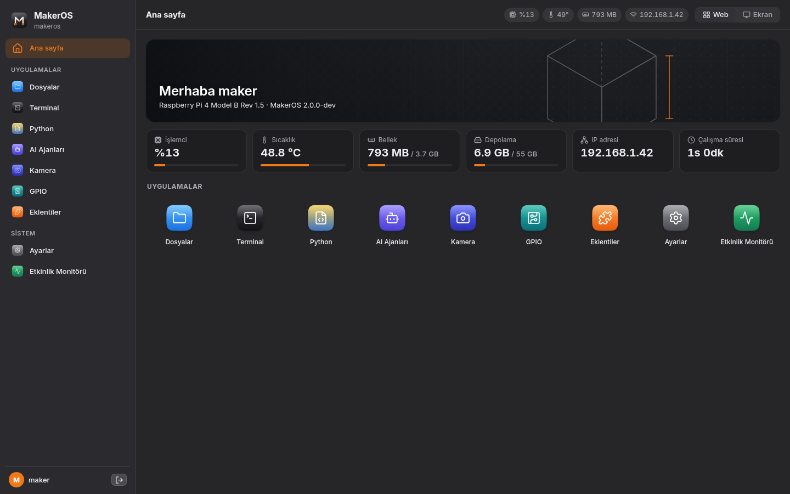
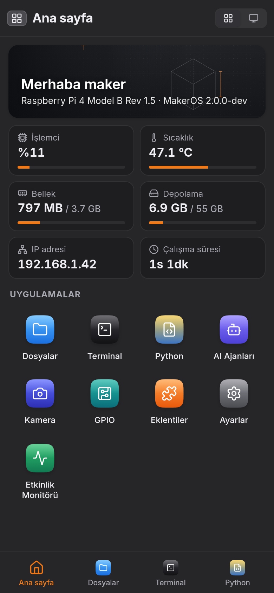
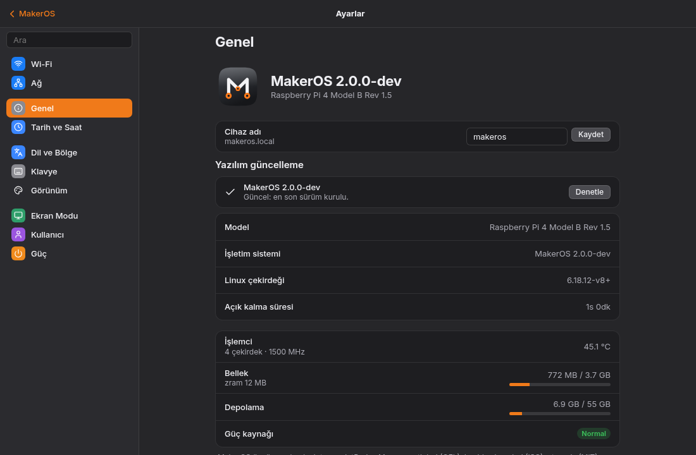

<p align="center">
  <a href="https://github.com/ferhatozcelik/maker-os">
    
  </a>
</p>

<h1 align="center">MakerOS</h1>

<p align="center">An independent maker operating system for the Raspberry Pi: students, makers and AI projects.</p>

<p align="center"><strong>Flash the SD card. Power on the Pi. Connect from a browser.</strong></p>

<p align="center">
  <a href="https://github.com/ferhatozcelik/maker-os/releases/tag/v2.0.0"></a>
  
  
  <a href="LICENSE"></a>
</p>

<p align="center">
  <a href="https://github.com/ferhatozcelik/maker-os/releases/latest">Download</a> ·
  <a href="#setup-guide">Setup guide</a> ·
  <a href="#features">Features</a> ·
  <a href="#build-from-source">Building from source</a> ·
  <a href="docs/v2/api.md">API</a> ·
  <a href="CONTRIBUTING.md">Contributing</a>
</p>

<p align="center">
  <a href="README.md">Türkçe</a> ·
  <a href="README.en.md">English</a>
</p>

<p align="center">
  <strong>Support the project</strong><br>
  <a href="https://buymeacoffee.com/ferhatozcelik">Buy Me a Coffee</a> ·
  <a href="https://thanks.dev/donations">thanks.dev</a>
</p>

<br>

<table align="center">
  <tr>
    <th align="center" colspan="2">Desktop · Chromium window (in the browser)</th>
  </tr>
  <tr>
    <td align="center" colspan="2"></td>
  </tr>
  <tr>
    <th align="center">Web interface</th>
    <th align="center">Phone</th>
  </tr>
  <tr>
    <td align="center" valign="top"></td>
    <td align="center" valign="top"></td>
  </tr>
  <tr>
    <th align="center" colspan="2">Settings · Software update</th>
  </tr>
  <tr>
    <td align="center" colspan="2"></td>
  </tr>
</table>

## Download

[Release 2.0.0](https://github.com/ferhatozcelik/maker-os/releases/latest): `makeros-2.0.0-rpi4.img.xz` (Raspberry Pi 4 / 400, 64-bit). Verify after downloading with `sha256sum -c makeros-*.img.xz.sha256`.

## Folders

| Piece | Folder |
| --- | --- |
| Operating system (Buildroot external tree, kernel, packages, image) | [`os/`](os/) |
| Backend service (Rust: API, terminal, files, plugin store, OTA, Chromium session) | [`makerd/`](makerd/) |
| Web desktop shell and system apps (zero-dependency ES modules) | [`shell/`](shell/) |
| Architecture plan, API contract, benchmark report and roadmap | [`docs/v2/`](docs/v2/) |

```bash
make -C makerd preview                # local preview: makerd (sample data) + shell → http://localhost/
make -C makerd test                   # makerd unit and integration tests
make -C shell smoke                   # shell smoke test (headless Chromium)
./os/build.sh build                   # Raspberry Pi image → os/out/makeros-<version>-rpi4.img.xz
```

<a id="features"></a>

## Features

| Area | What you get |
| --- | --- |
| Base | Independent system built with Buildroot on Linux 6.18 (Raspberry Pi); read-only EROFS root file system, A/B partitions, systemd |
| Two views | One address (`http://maker-os.local/`): the windowed **Screen** (desktop, dock, windows) and the phone-friendly **Web** interface, switched with *Web \| Screen*. Installable as a web app (PWA) |
| Chromium | A normal window on the desktop: the real browser running on the Pi, drawn on a separate invisible display with only that window streamed; resizes with the window and stops when closed |
| Files and terminal | Upload and download; click a `.py` file to run it. The web terminal shares its session with the Pi’s screen, with an extra key bar for phones |
| Python | `uv` projects with virtual environments and Python versions; templates: LED, button, I2C scanner, camera, web, AI object detection |
| AI agents and Local Assistant | **makeros-ai** (offline Turkish Linux assistant powered by Qwen2.5-0.5B + `llama.cpp`, risk-classified command execution and desktop AI Assistant widget); Claude Code, Codex CLI, Gemini CLI, OpenCode and Ollama: install, update, run |
| Hardware | GPIO (40-pin), I2C, SPI, UART; Pi camera and USB cameras (`libcamera`) |
| Plugins and Store | Python plugins, **Plugin Store** (one-click install and update directly from the [`makeros-plugins`](https://github.com/ferhatozcelik/makeros-plugins) repository), zip import/export, template; plugins can add themes, menu bar indicators and desktop/web widgets |
| Software update | Settings › General finds a new release on GitHub, downloads and verifies the signed RAUC package and installs it to the spare partition. If the new version fails to start, the Pi returns to the previous one; files and settings are kept |
| Network | Ethernet, Wi-Fi, hidden networks, WPA2-Enterprise; with no network an open `MakerOS` setup Wi-Fi and captive setup page |
| Monitoring | Activity Monitor: CPU, memory, temperature and process management |
| Themes | Maker, Hackerspace, Hardware, Cybersecurity, 3D printing; light/dark appearance and accent colour |

<a id="setup-guide"></a>

## Setup guide

MakerOS runs on Raspberry Pi 4 Model B and Raspberry Pi 400 (64-bit). It can be used with a display attached or completely headless over the network from any browser.

### 1. Flash the SD card

1. Download `makeros-<version>-rpi4.img.xz` from the [release page](https://github.com/ferhatozcelik/maker-os/releases/latest).
2. Open Raspberry Pi Imager, choose **Use custom**, select the downloaded archive and write it to an SD card. Imager’s OS customisation settings are not used by MakerOS.
3. *(Optional — preconfigured Wi-Fi)* While the card is mounted, copy `wifi-example.txt` on the `MOSCFG` partition to `wifi.txt` and fill in your SSID and password. It is read on first boot and deleted for safety.

### 2. Power on and connect

1. Insert the SD card into the Raspberry Pi and power it on.
2. With Ethernet plugged in or `wifi.txt` configured, open **http://maker-os.local/** from a browser on your computer or phone.
3. Without Ethernet or `wifi.txt`, connect your phone to the open **`MakerOS`** Wi-Fi network. The setup page opens automatically (or visit `http://10.42.0.1/kurulum`).
4. In the first-boot wizard, select a Wi-Fi network or skip this step. The device is set up with the default **`makeros` / `makeros`** administrator account and the Pi's own display signs in automatically. Sign in with these credentials from another computer and change the password under **Settings → User**.

### 3. Use Screen and Web views

- **Screen view (`/`):** Full windowed desktop with menu bar, dock, desktop widgets, Chromium browser window, Spotlight search (`⌘K`), Control Centre and Notification Centre.
- **Web view (`/web`):** Sidebar navigation (bottom tab bar on phones) and live status cards for direct access to every system app without floating windows. Switch between the two at any time with the **Web | Screen** toggle in the top bar (or the Web icon on the dock).

### 4. Software update (OTA)

A/B partition updates require Raspberry Pi bootloader (EEPROM) version `2025-03` or newer.

1. Open **Settings → General → Software update**.
2. Click **Check** to look for a new release on GitHub Releases.
3. Click **Update** to download the signed `.raucb` bundle, verify its SHA-256 digest and X.509 signature, and write it to the inactive root slot (`ROOT_A` / `ROOT_B`).
4. On reboot the Pi tests the new slot via `tryboot`; if boot does not complete, it automatically rolls back to the previous slot. User data and settings on `/data` are preserved.

<a id="build-from-source"></a>

### 5. Building from source

All build and test tools run inside Docker; nothing is installed on the host machine.

1. **Prepare the Chromium bundle (once before the first build):**
   ```bash
   docker run --rm -v "$PWD/os/chromium":/s:ro -v "$PWD/os/out":/out debian:trixie sh /s/build-bundle.sh
   ```
2. **Build the SD card image:**
   ```bash
   ./os/build.sh build
   ```
   The output is written to `os/out/makeros-<version>-rpi4.img.xz`.
3. **Signed update bundle (`.raucb`):** Produced only when the private key `os/keys/rauc-key.pem` is present (never committed to git). Official releases are built and published by GitHub Actions ([`.github/workflows/release.yml`](.github/workflows/release.yml)) when `os/VERSION` is bumped and pushed to `main`.

## Verification status

Screenshots were taken from the current build in Docker; device data such as temperature, memory and network are sample values. The interface, `makerd` and the Chromium window have been tested end to end in Docker with the built root file system. There is no performance data measured on real Raspberry Pi hardware yet; see [`docs/v2/BENCHMARK.md`](docs/v2/BENCHMARK.md) for the virtual benchmark report. Please report issues on [Issues](https://github.com/ferhatozcelik/maker-os/issues).

## License

[GPL-3.0-or-later](LICENSE) — See [`NOTICE.md`](NOTICE.md) for third-party component licenses and copyright notices.

## Trademarks and legal notice

The original source code, build scripts, configuration and examples developed in this repository are provided under the **GNU General Public License version 3 or any later version** (`GPL-3.0-or-later`). This does not mean all software in the image has the same license: the Linux kernel, Raspberry Pi firmware, Chromium, WPE WebKit, Mesa and other third-party components belong to their respective owners and licenses ([`NOTICE.md`](NOTICE.md)).

**MakerOS is an independent community project.** It is not developed on behalf of Raspberry Pi Ltd and claims no partnership, sponsorship, certification, endorsement or official support. **Raspberry Pi is a trademark of Raspberry Pi Ltd.** References to the trademark only identify the target hardware; the software license grants no trademark or logo rights ([Raspberry Pi trademark rules](https://www.raspberrypi.com/trademark-rules/)). All rights to the Konya HackerSpace name and mark used in the default plugin belong to Konya HackerSpace.

The software is provided **as is, without warranty**, to the extent permitted by applicable law and as stated in the licenses.
