<p align="center">
  <a href="https://github.com/ferhatozcelik/maker-os">
    
  </a>
</p>

<h1 align="center">MakerOS</h1>

<p align="center">An independent, fully open-source Linux operating system for ARM64, Pi 4 compatible boards.</p>

<p align="center"><strong>Your workshop, in your pocket.</strong></p>

<p align="center">
  <a href="https://github.com/ferhatozcelik/maker-os/releases/tag/v1.0.0"></a>
  
  
  <a href="LICENSE"></a>
</p>

<p align="center">
  <a href="https://ferhatozcelik.github.io/maker-os/">Website</a> ·
  <a href="https://github.com/ferhatozcelik/maker-os/releases/latest">Download</a> ·
  <a href="#features">Features</a> ·
  <a href="#architecture">How it works</a> ·
  <a href="#packages">Packages</a> ·
  <a href="#plugins">Plugins</a> ·
  <a href="#performance">Performance</a> ·
  <a href="#setup-guide">Setup</a> ·
  <a href="#documentation">Documentation</a> ·
  <a href="docs/api.en.md">API</a> ·
  <a href="CONTRIBUTING.md">Contribute</a>
</p>

<p align="center">
  <a href="README.md">Türkçe</a> ·
  <a href="README.en.md">English</a>
</p>

<br>

<table align="center">
  <tr>
    <th align="center" colspan="2">Desktop · Browser & Local AI Assistant</th>
  </tr>
  <tr>
    <td align="center" colspan="2">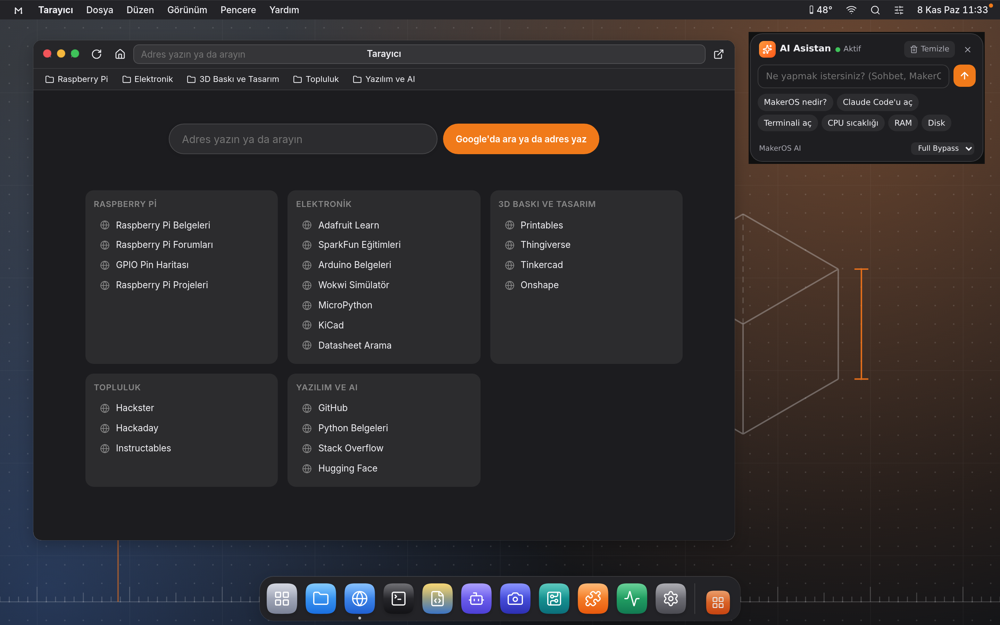</td>
  </tr>
  <tr>
    <th align="center">Web Interface</th>
    <th align="center">Mobile</th>
  </tr>
  <tr>
    <td align="center" valign="top">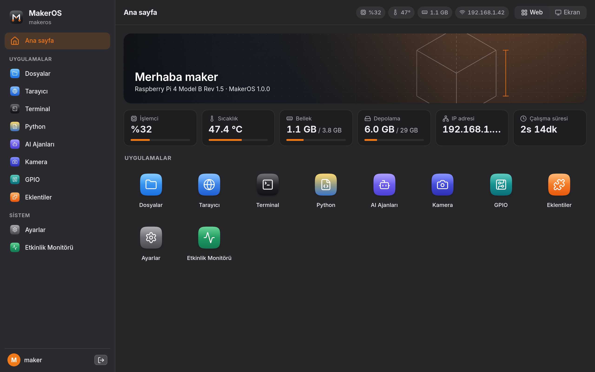</td>
    <td align="center" valign="top">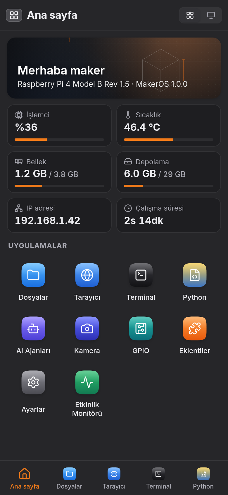</td>
  </tr>
  <tr>
    <th align="center" colspan="2">Settings · General & Software Update</th>
  </tr>
  <tr>
    <td align="center" colspan="2">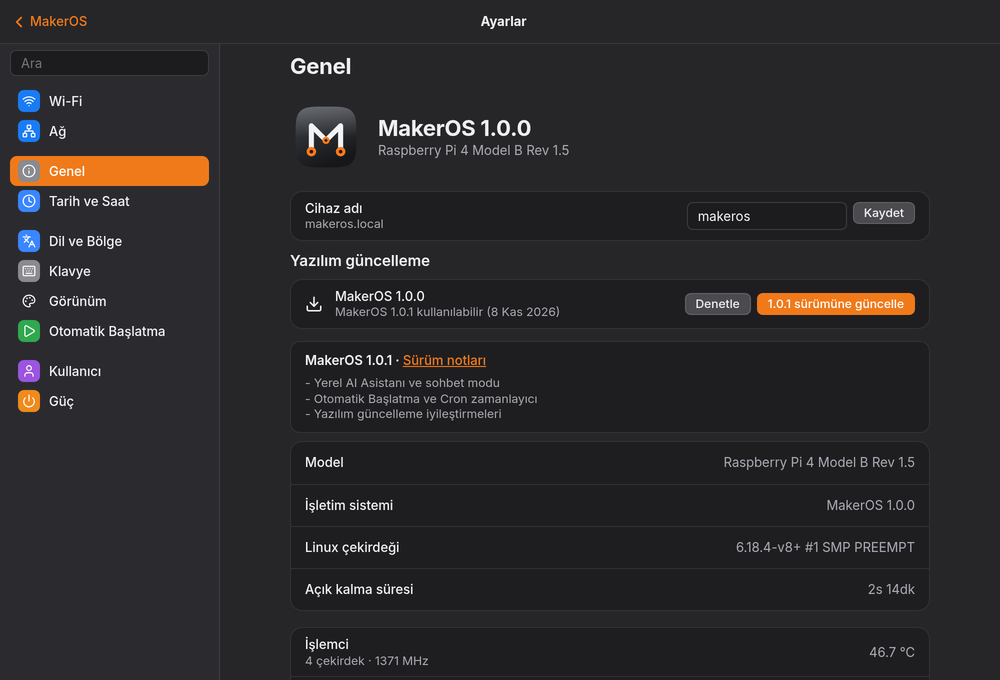</td>
  </tr>
</table>

## What is MakerOS?

MakerOS is an independent, open-source Linux operating system for Pi 4 / 400 compatible ARM64 boards. Plug the board into a display and use it like a desktop computer, or use it remotely from any browser on your network or from your phone. A terminal, file manager, Python projects, GPIO, camera and an offline AI assistant come built in.

**Computing should be personal again.** MakerOS started on a small ARM board with a simple question: *"Can we design a computer that truly belongs to us?"* The goal is a system that needs no expensive hardware, that you can understand and change, and that helps you build your ideas.

> Technology should not tell you what to do — it should expand what you can build.
>
> **Your workshop, in your pocket.**

## Download

[Release 1.0.0](https://github.com/ferhatozcelik/maker-os/releases/latest): `makeros-1.0.0-rpi4.img.xz` (Pi 4 / 400 compatible boards, ARM64) and the signed update bundle `makeros-1.0.0-rpi4.raucb`. Easiest: the one-line command in [Setup](#setup-guide) writes a fresh card, or updates the card inside the Pi over USB-C.

<a id="features"></a>

## Features

| Feature | Description |
| --- | --- |
| **One desktop, everywhere** | The same interface on the board's display, in a browser on your network, and on your phone. |
| **One-command install** | The same command writes a fresh card in a reader, or updates the card inside the Pi over USB-C. |
| **Safe updates** | New versions install to a spare copy of the system; if anything goes wrong, the board rolls back on its own. |
| **Local AI assistant** | An assistant that works without internet; it answers questions and runs commands only with your permission. |
| **Package installs** | Debian-style `apt install`; packages go into your personal space on the microSD. |
| **Python & automation** | Python projects from ready-made templates; run them at boot or on a schedule. |
| **Hardware & camera** | Live GPIO control, I²C / SPI / UART, live video from CSI and USB cameras. |
| **Plugins & themes** | A [plugin store](#plugins) (Home Assistant, Pi-hole, Chromecast…), ready-made themes and a light, low-power look. |

<a id="architecture"></a>

## How It Works

<p align="center">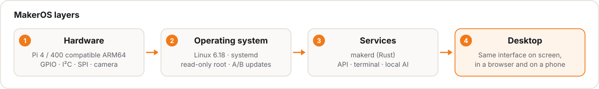</p>

| Layer | What it does |
| --- | --- |
| **1. Hardware** | The board the system runs on. Pins, sensors and the camera live here. |
| **2. Operating system** | The Linux kernel and core services. System files are read-only, so they can't be broken by accident. |
| **3. Services** | `makerd`: the background program that safely does everything the interface asks for (files, terminal, network, AI, updates). |
| **4. Desktop** | The interface you see. It is web-based, so it works the same on screen, in a browser and on a phone. |

Details: [Desktop](docs/architecture/desktop.en.md) · [Services](docs/architecture/backend.en.md) · [Local AI](docs/architecture/ai-assistant.en.md) · [Hardware](docs/architecture/hardware.en.md)

### microSD card

<p align="center">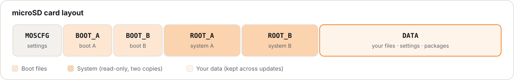</p>

| Partition | What it does |
| --- | --- |
| **MOSCFG** | Stores which system copy to boot and optional Wi-Fi settings. You can open and edit it on your computer. |
| **BOOT_A / BOOT_B** | Files that start the board; each system copy has its own boot partition. |
| **ROOT_A / ROOT_B** | Two copies of the operating system. One is in use while the other waits for the next update. |
| **DATA** | Your space: files, settings, projects and installed packages. Updates never touch it. |

### Boot

<p align="center">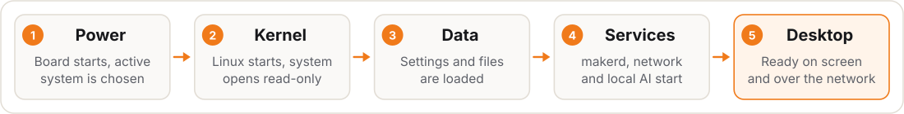</p>

1. **Power:** The board starts and picks the last working system copy (A or B).
2. **Kernel:** Linux starts; system files are mounted read-only.
3. **Data:** The `DATA` partition is checked and mounted; your settings and files come back.
4. **Services:** `makerd`, networking and the local AI start. Without a network, the board opens its own `MakerOS` Wi-Fi.
5. **Desktop:** The interface opens on screen and is reachable over the network at the same time.

### Update

<p align="center">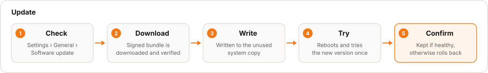</p>

1. **Check:** Settings › General › Software update looks for a new version. Without internet, you can also send the same bundle from a computer over USB-C ([Setup](#setup-guide), choice 2).
2. **Download:** The update bundle is downloaded and its signature verified; tampered bundles are rejected.
3. **Write:** The bundle is written to the system copy that is not in use. The running system is untouched.
4. **Try:** The board boots the new version **once**.
5. **Confirm:** If all is well, the new version becomes permanent; if boot fails, the board automatically returns to the previous version.

Details: [Boot & storage](docs/architecture/boot-and-storage.en.md)

<a id="packages"></a>

## Installing Packages (`apt` / `mos pkg`)

<p align="center">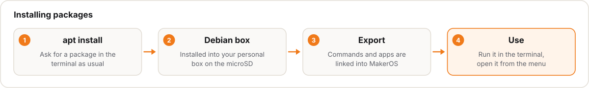</p>

Because system files are read-only, packages are installed into your **personal Debian box** on the microSD instead of the system. You won't notice the difference: commands run in the terminal and apps appear in the menu.

1. **apt install:** Ask for a package in the terminal, just like on Debian.
2. **Debian box:** The package is installed into your personal box on the `DATA` partition. The system is untouched and updates never remove it.
3. **Export:** The package's commands and apps are linked into MakerOS.
4. **Use:** Run the command in the terminal or open the app from the menu.

```bash
apt install htop      # install a package
htop                  # run it directly
apt remove htop       # remove it
mos box               # enter a full Debian shell
```

Details: [Package manager](docs/architecture/packages.en.md)

<a id="plugins"></a>

## Plugins

Plugins come from the [makeros-plugins](https://github.com/ferhatozcelik/makeros-plugins) repository and install with one click from **Plugins › Store** in MakerOS. Every file is checked against the repository; when a new version lands, an "Update" button appears. Current list: [plugin store](https://ferhatozcelik.github.io/maker-os/#plugins)

| Plugin | What it does |
| --- | --- |
| [Home Assistant](https://github.com/ferhatozcelik/makeros-plugins/tree/main/plugins/homeassistant) | Home Assistant runs on the board; its own UI opens in MakerOS's theme, selected entities on a desktop widget. |
| [Pi-hole](https://github.com/ferhatozcelik/makeros-plugins/tree/main/plugins/pihole) | Network-wide ad and tracker blocking; stats and blocking on/off. |
| [Chromecast](https://github.com/ferhatozcelik/makeros-plugins/tree/main/plugins/chromecast) | Finds Google Cast devices on your network; shares the MakerOS screen on your TV. |
| [Konya HackerSpace](https://github.com/ferhatozcelik/makeros-plugins/tree/main/plugins/khs) | KHS theme, door status and the konyahackerspace.org app. |

**Write your own:** a plugin is a Python folder with `plugin.json`, `pyproject.toml` and `main.py`. Create the template with `mos plugin new <name>` in the MakerOS terminal; once the folder lands in the repository, it shows up in the store. Details: [plugin guide](https://github.com/ferhatozcelik/makeros-plugins#eklenti-eklemek)

<a id="performance"></a>

## Performance

Raspberry Pi 4 Model B (4 GB), MakerOS 1.0.0, no overclock, microSD card. Median of three MakerOS Bench runs (22 November 2026):

| Test | Result |
| --- | ---: |
| CPU integer · single core | 0.83 M ops/s |
| CPU integer · 4 cores | 3.28 M ops/s (4.0×) |
| SHA-256 | 143 MB/s |
| zlib compression | 12.3 MB/s |
| Memory copy | 2.70 GB/s |
| Sequential read / write (fsync) | 46.3 / 20.5 MB/s |
| Random 4K read / write (fsync) | 2,062 / 133 IOPS |
| Peak temperature under load | 52.6 °C |

All tests with ranges: [website](https://ferhatozcelik.github.io/maker-os/#performance). The tests are Python workloads; disk results depend on the microSD card used.

### Compared with other boards

Geekbench 5.4.0 (Linux AArch64) on the same Pi 4 running MakerOS 1.0.0: **215 single-core / 634 multi-core** ([result](https://browser.geekbench.com/v5/cpu/24849878)). Other boards are medians of Linux results on Geekbench Browser (27 November 2026).

<p align="center">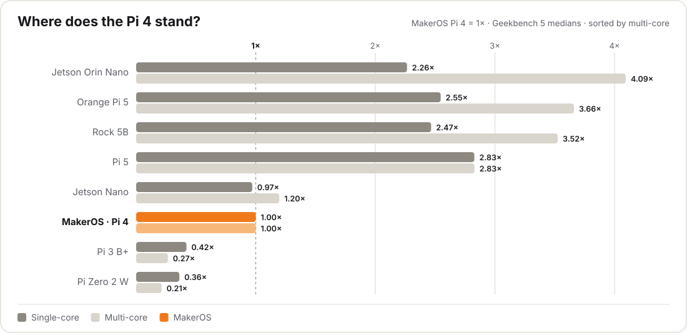</p>

| Board | CPU | Single-core | Multi-core | Samples |
| --- | --- | ---: | ---: | ---: |
| Pi Zero 2 W | BCM2710A1 · 4× A53 1.0 GHz | 86 | 149 | 147 |
| Pi 3 B+ | BCM2837B0 · 4× A53 1.4 GHz | 100 | 186 | 199 |
| **Pi 4 · MakerOS 1.0.0** | **BCM2711 · 4× A72 1.5 GHz** | **215** | **634** | **1** |
| Pi 4 · other Linux distros | BCM2711 · 4× A72 1.5 GHz | 237 | 691 | 25 |
| Jetson Nano | Tegra X1 · 4× A57 1.43 GHz | 231 | 839 | 35 |
| Pi 5 | BCM2712 · 4× A76 2.4 GHz | 673 | 1,983 | 125 |
| Rock 5B | RK3588 · 4× A76 + 4× A55 | 587 | 2,471 | 187 |
| Orange Pi 5 | RK3588S · 4× A76 + 4× A55 | 606 | 2,566 | 82 |
| Jetson Orin Nano | Orin · 6× A78AE | 539 | 2,870 | 30 |

- **Same board:** MakerOS is about **9% (single) / 8% (multi)** behind the median of other Linux distributions at the stock clock (1.5 GHz; Raspberry Pi OS, Ubuntu etc., Geekbench does not tell them apart). This is a single run, taken with the `ondemand` CPU governor and the desktop running.
- The Pi 4 is ~2× a Pi 3 B+ single-core and ~3.4× multi-core; the Pi 5 and RK3588 boards are roughly 3–4× a Pi 4.
- **zstd -19** (same file, single thread): MakerOS 686 s vs. a published Raspbian 10 result of 291 s. The source used 32-bit zstd 1.3.4, so the gap cannot be put on the OS alone.

Source data and method: [benchmark/boards.json](benchmark/boards.json) · [MakerOS Bench result](benchmark/results/20261126-2334-makeros-raspberry-pi-4-rev-1-2-4-gb-makeros-1-0-0.md). To regenerate the chart: `python3 docs/assets/diagrams/bench.py`

<a id="setup-guide"></a>

## Setup

### 1. Install or update

<p align="center">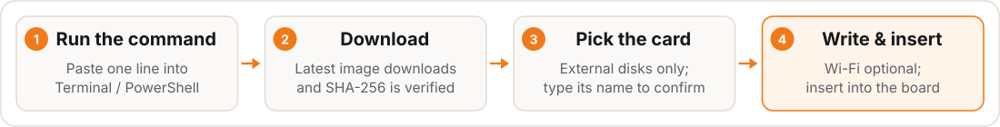</p>

A one-line command downloads the latest release, verifies it and installs it. It first asks how the card is connected:

| Choice | When? | What happens |
| --- | --- | --- |
| **1) SD — card reader** | Fresh install; card in your computer | The card is written from scratch. It can also add your Wi-Fi details so the board joins your network on first boot. |
| **2) USB — Pi over USB-C** | MakerOS already installed; card inside the Pi | Connect the Pi to your computer with a USB-C cable; no need to remove the card. The signed update bundle is sent over USB-C and installed to the spare slot. Your files and settings are kept; if the new version fails to boot, the Pi falls back to the previous one. |

**macOS / Linux** — open Terminal and paste:

```bash
sh -c "$(curl -fsSL https://raw.githubusercontent.com/ferhatozcelik/maker-os/main/flash.sh)"
```

<p align="center">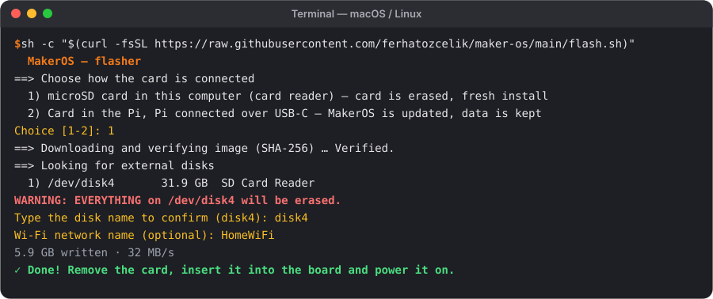</p>

> USB mode signs in with your MakerOS admin account (default `maker` / `maker`). If your computer's USB port cannot power the Pi, use a powered USB hub. To skip the question, append `-- -m sd` or `-- -m usb`: `sh -c "$(curl -fsSL …/flash.sh)" -- -m usb`.

**Windows** — right-click *PowerShell* in the Start menu, choose **Run as administrator** and paste (or download [`flash.cmd`](flash.cmd) and double-click it):

```powershell
irm https://raw.githubusercontent.com/ferhatozcelik/maker-os/main/flash.ps1 | iex
```

Windows supports SD (card reader) mode only; USB mode is for macOS and Linux.

<p align="center">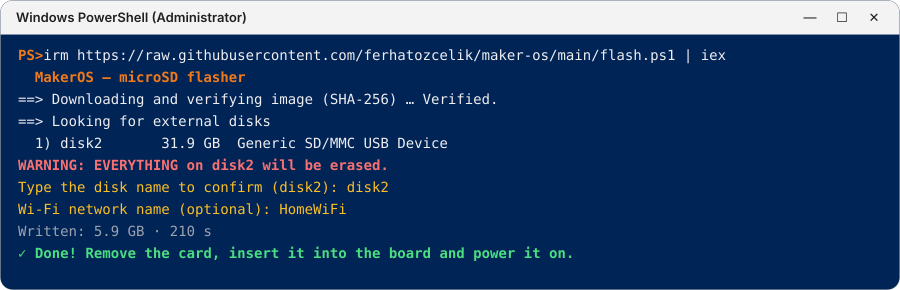</p>

SD mode steps:

| Step | What happens |
| --- | --- |
| **1. Run the command** | The script runs straight from GitHub; nothing else to install. |
| **2. Download** | The latest release downloads and its SHA-256 checksum is verified. Corrupt or tampered files are never written. |
| **3. Pick the card** | Only external / removable disks are listed. Your computer's own disk is never shown; you confirm by typing the disk name (e.g. `disk4`). |
| **4. Write & insert** | The image is written, `wifi.txt` is added if you gave Wi-Fi details, and the card is ready to remove. |

> If Windows asks to format the card after writing, click **Cancel**. To flash manually, write the `.img.xz` from the [release page](https://github.com/ferhatozcelik/maker-os/releases/latest) with a tool like balenaEtcher.

### 2. Boot and connect

1. **Boot:** Insert the card into the board and power it on. The first boot takes a minute or two.
2. **Connect:** Open `http://maker-os.local/` on the same network or `http://10.42.0.1/` over USB-C; without a network, join the `MakerOS` Wi-Fi and open `http://10.42.0.1/kurulum`.
3. **Sign in:** The default account is **`maker` / `maker`**. Change the password in **Settings › User**.

<a id="documentation"></a>

## Documentation

All documents are available in English and Turkish. Start here: [`docs/`](docs/README.en.md)

| Topic | English | Türkçe |
| --- | --- | --- |
| Overview | [overview.en.md](docs/architecture/overview.en.md) | [overview.md](docs/architecture/overview.md) |
| Boot & storage | [boot-and-storage.en.md](docs/architecture/boot-and-storage.en.md) | [boot-and-storage.md](docs/architecture/boot-and-storage.md) |
| Desktop | [desktop.en.md](docs/architecture/desktop.en.md) | [desktop.md](docs/architecture/desktop.md) |
| Services (Rust) | [backend.en.md](docs/architecture/backend.en.md) | [backend.md](docs/architecture/backend.md) |
| Package manager | [packages.en.md](docs/architecture/packages.en.md) | [packages.md](docs/architecture/packages.md) |
| Local AI assistant | [ai-assistant.en.md](docs/architecture/ai-assistant.en.md) | [ai-assistant.md](docs/architecture/ai-assistant.md) |
| Network & security | [network-security.en.md](docs/architecture/network-security.en.md) | [network-security.md](docs/architecture/network-security.md) |
| Hardware | [hardware.en.md](docs/architecture/hardware.en.md) | [hardware.md](docs/architecture/hardware.md) |
| Build & test | [build-and-test.en.md](docs/development/build-and-test.en.md) | [build-and-test.md](docs/development/build-and-test.md) |
| Validation status | [validation.en.md](docs/verification/validation.en.md) | [validation.md](docs/verification/validation.md) |
| Branding & licensing | [branding-and-licensing.en.md](docs/project/branding-and-licensing.en.md) | [branding-and-licensing.md](docs/project/branding-and-licensing.md) |
| HTTP/WS API | [api.en.md](docs/api.en.md) | [api.md](docs/api.md) |

<a id="build-from-source"></a>

## Build from Source

```bash
make -C makerd preview     # preview on your computer → http://localhost:8080/
make -C shell smoke        # interface tests
./os/build.sh build        # build the microSD image → os/out/
```

Source directories: [`os/`](os/README.md) (operating system and image) · [`makerd/`](makerd/) (services) · [`shell/`](shell/README.md) (desktop) · [`site/`](site/index.html) ([project website](https://ferhatozcelik.github.io/maker-os/)). Details: [Build & test](docs/development/build-and-test.en.md) · [Validation status](docs/verification/validation.en.md)

## License

[MIT](LICENSE). Third-party components: [`NOTICE.md`](NOTICE.md).

MakerOS is an independent open-source project, not affiliated with any hardware or software vendor. Product names are trademarks of their respective owners.
