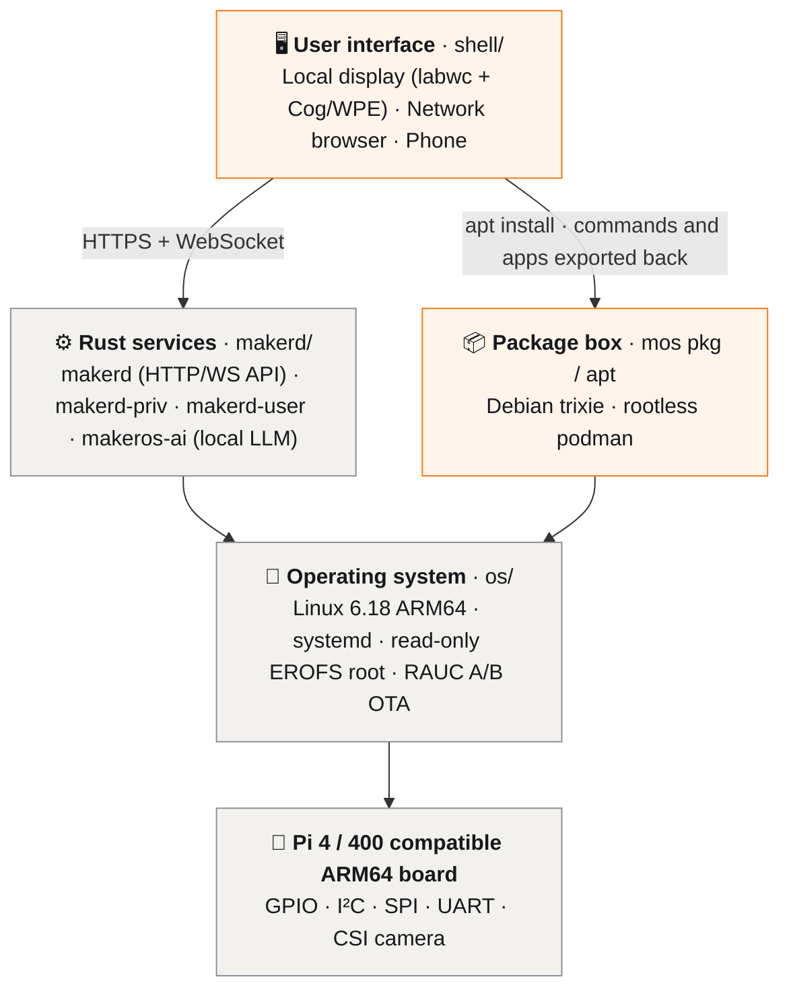
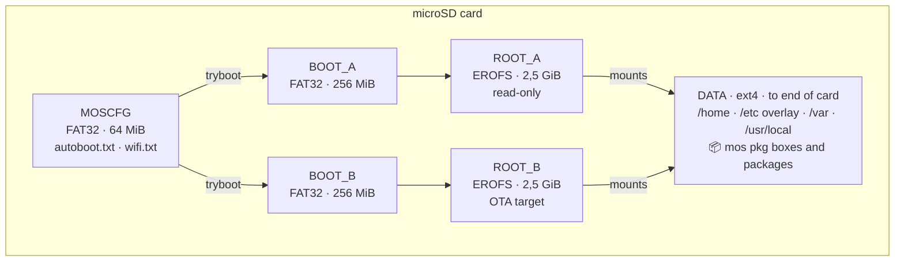
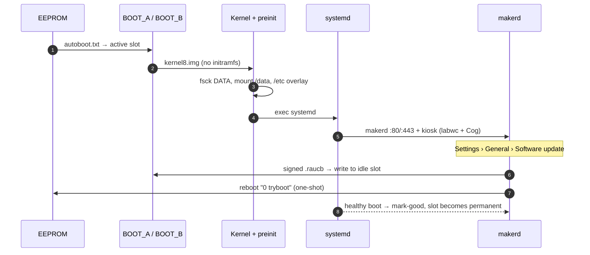
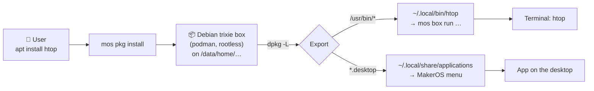

<p align="center">
  <a href="https://github.com/ferhatozcelik/maker-os">
    
  </a>
</p>

<h1 align="center">MakerOS</h1>

<p align="center">An independent, fully open-source Linux operating system for ARM64, Pi 4 compatible boards.</p>

<p align="center"><strong>Your workshop, in your pocket.</strong></p>

<p align="center">
  <a href="https://github.com/ferhatozcelik/maker-os/releases/tag/v1.0.0"></a>
  
  
  <a href="LICENSE"></a>
</p>

<p align="center">
  <a href="https://github.com/ferhatozcelik/maker-os/releases/latest">Download</a> ·
  <a href="#features">Features</a> ·
  <a href="#architecture">Architecture</a> ·
  <a href="#packages">Packages</a> ·
  <a href="#setup-guide">Setup Guide</a> ·
  <a href="#documentation">Documentation</a> ·
  <a href="docs/api.en.md">API</a> ·
  <a href="CONTRIBUTING.md">Contribute</a>
</p>

<p align="center">
  <a href="README.md">Türkçe</a> ·
  <a href="README.en.md">English</a>
</p>

<p align="center">
  <strong>Support the project</strong><br>
  <a href="https://buymeacoffee.com/ferhatozcelik">Buy Me a Coffee</a> ·
  <a href="https://thanks.dev/donations">thanks.dev</a>
</p>

<br>

<table align="center">
  <tr>
    <th align="center" colspan="2">Desktop · Browser & Local AI Assistant</th>
  </tr>
  <tr>
    <td align="center" colspan="2"></td>
  </tr>
  <tr>
    <th align="center">Web Interface</th>
    <th align="center">Mobile</th>
  </tr>
  <tr>
    <td align="center" valign="top"></td>
    <td align="center" valign="top"></td>
  </tr>
  <tr>
    <th align="center" colspan="2">Settings · General & Software Update</th>
  </tr>
  <tr>
    <td align="center" colspan="2"></td>
  </tr>
</table>

## What is MakerOS?

MakerOS is an independent Linux operating system running on accessible hardware such as Pi 4 compatible ARM64 boards, designed to give users full ownership and freedom over their computer and digital workspace. Instead of layering a theme onto a generic distribution, MakerOS builds its own image from the ground up—unifying its boot chain, Rust system services (`makerd`), web desktop shell, A/B OTA update system, and offline AI assistant into a single cohesive platform.

It combines clarity and ease of use with the flexibility of Linux, while maintaining its own identity, lightweight technical architecture, and open-source maker philosophy.

**Computing should be personal again.** Modern operating systems increasingly lock users inside black-box ecosystems and opaque background services. MakerOS started on a small ARM board with a simple question: *"Can we design a computer that truly belongs to us?"* Our goal is to make capable computing accessible without expensive hardware—providing a transparent system that you can understand, modify, and use to build what matters to you.

MakerOS is guided by five core principles: **Freedom** (you own your machine), **Simplicity** (powerful tools without unnecessary complexity), **Productivity** (built for creation, not just consumption), **Transparency** (clear visibility into services, hardware, and state), and **Accessibility** (engineered for affordable ARM64 devices). Artificial intelligence in MakerOS is designed to expand human capability rather than take control away from the user.

> **Manifesto:** We do not believe computers exist merely for consumption, nor that great design must come at the cost of user freedom. Simplicity and openness belong together. Technology should not tell you what to do—it should expand what you can build.
>
> **Your workshop, in your pocket.**

## Download

[Release 1.0.0](https://github.com/ferhatozcelik/maker-os/releases/latest): `makeros-1.0.0-rpi4.img.xz` (Pi 4 / 400 compatible boards, ARM64). Verify after download with `sha256sum -c makeros-*.img.xz.sha256`.

<a id="features"></a>

## Features

| Area | Overview |
| --- | --- |
| **Base System** | Custom Buildroot + Linux 6.18 (ARM64) distribution; read-only EROFS rootfs, persistent ext4 `/data` partition, RAUC + `tryboot` A/B updates, systemd |
| **Desktop & Web** | Shared experience on local display (Cog/WPE WebKit) and remote browsers: windowed **Desktop** (`/`) and mobile-ready **Web** (`/web`) interface |
| **Rust Backend** | `makerd` (HTTP/WS API), `makerd-priv` (privileged operations), `makerd-user` (user processes & PTY terminal), `makeros-ai` (local AI daemon) |
| **Local AI Assistant** | Offline assistant powered by Qwen2.5-0.5B-Instruct GGUF + `llama.cpp`; conversational mode, MakerOS knowledge cards, context reset, risk classification, and Full Bypass / Ask execution modes |
| **Package Manager** | Debian-style `apt install` / `mos pkg`: packages install into a per-user box on the microSD (Debian trixie, rootless podman); commands and apps are exported to MakerOS automatically ([details](docs/architecture/packages.en.md)) |
| **Python & Automation** | `uv`-based virtual environment and project manager with ready-made GPIO/Camera/Web/AI templates; **Autostart** and **Cron** scheduler for boot and periodic execution |
| **Hardware & Camera** | Live 40-pin GPIO control, I²C, SPI, UART; live MJPEG streaming and photo capture for CSI and USB cameras |
| **Plugins & Themes** | Python plugin architecture, Plugin Store (`makeros-plugins`), `.zip` import/export; Maker (default), Hardware, Cyber, 3D Print, and Konya HackerSpace themes, flat low-GPU mode, and granular System UI toggles |

<a id="architecture"></a>

## Architecture

MakerOS is built in layers; each layer lives in its own directory and has its own document.



**Layer documents:** [Desktop shell](docs/architecture/desktop.en.md) · [Rust backend](docs/architecture/backend.en.md) · [Local AI](docs/architecture/ai-assistant.en.md) · [Package manager](docs/architecture/packages.en.md) · [Boot & storage](docs/architecture/boot-and-storage.en.md) · [Network & security](docs/architecture/network-security.en.md) · [Hardware](docs/architecture/hardware.en.md)

### microSD partition layout

The system runs from two read-only root slots (A/B); all user data and installed packages live on the `DATA` partition, so updates never touch your data. Details: [Boot & Storage](docs/architecture/boot-and-storage.en.md).



### Boot and update flow



<a id="packages"></a>

## Package Manager (`mos pkg` / `apt`)

Even though the root filesystem is read-only, you can install packages just like on Debian. `mos pkg` (or the familiar `apt` / `apt-get`) installs packages into a rootless Debian trixie box stored on the microSD `DATA` partition. The package's commands and desktop apps are exported to MakerOS automatically: they run straight from the terminal and show up in the app menu. Details: [Package Manager](docs/architecture/packages.en.md).



```bash
apt install htop           # or: mos pkg install htop
htop                       # runs directly in the MakerOS terminal
mos pkg list               # packages installed with mos pkg
apt upgrade                # upgrade box packages, refresh exports
apt remove htop            # remove package and its exported commands
mos box                    # enter a full Debian shell (sudo apt, gcc, make …)
```

<a id="documentation"></a>

## Documentation

All documents are available in English and Turkish; start at [`docs/`](docs/README.en.md).

| Topic | English | Türkçe |
| --- | --- | --- |
| Overview | [overview.en.md](docs/architecture/overview.en.md) | [overview.md](docs/architecture/overview.md) |
| Boot & storage | [boot-and-storage.en.md](docs/architecture/boot-and-storage.en.md) | [boot-and-storage.md](docs/architecture/boot-and-storage.md) |
| Desktop shell | [desktop.en.md](docs/architecture/desktop.en.md) | [desktop.md](docs/architecture/desktop.md) |
| Rust backend | [backend.en.md](docs/architecture/backend.en.md) | [backend.md](docs/architecture/backend.md) |
| Package manager | [packages.en.md](docs/architecture/packages.en.md) | [packages.md](docs/architecture/packages.md) |
| Local AI assistant | [ai-assistant.en.md](docs/architecture/ai-assistant.en.md) | [ai-assistant.md](docs/architecture/ai-assistant.md) |
| Network & security | [network-security.en.md](docs/architecture/network-security.en.md) | [network-security.md](docs/architecture/network-security.md) |
| Hardware | [hardware.en.md](docs/architecture/hardware.en.md) | [hardware.md](docs/architecture/hardware.md) |
| Build & test | [build-and-test.en.md](docs/development/build-and-test.en.md) | [build-and-test.md](docs/development/build-and-test.md) |
| Validation status | [validation.en.md](docs/verification/validation.en.md) | [validation.md](docs/verification/validation.md) |
| Branding & licensing | [branding-and-licensing.en.md](docs/project/branding-and-licensing.en.md) | [branding-and-licensing.md](docs/project/branding-and-licensing.md) |
| HTTP/WS API | [api.en.md](docs/api.en.md) | [api.md](docs/api.md) |

Source directories: [`os/`](os/README.md) (Buildroot external tree, kernel, packages, image) · [`makerd/`](makerd/) (Rust system services and AI) · [`shell/`](shell/README.md) (web desktop and apps) · [`site/`](site/index.html) ([project website](https://ferhatozcelik.github.io/maker-os/)).

<a id="setup-guide"></a>

## Setup Guide

1. **Flash the Image:** Download `makeros-1.0.0-rpi4.img.xz` from [Releases](https://github.com/ferhatozcelik/maker-os/releases/latest) and flash it to an SD card with any image writer (e.g. balenaEtcher or `dd`). Optionally copy `wifi-example.txt` to `wifi.txt` on the `MOSCFG` partition to preconfigure Wi-Fi.
2. **Boot & Connect:** Insert the SD card into your Pi 4 / 400 compatible board and power it on. Open `http://maker-os.local/` on your local network, `http://10.55.0.1/` over USB-C, or connect to the open `MakerOS` setup Wi-Fi hotspot (`http://10.42.0.1/kurulum`).
3. **Sign In:** Default credentials are **`makeros` / `makeros`**. Change your password anytime under **Settings › User**.
4. **OTA Updates:** Check and install signed `.raucb` updates from **Settings › General › Software Update** with automatic `tryboot` rollback protection.

<a id="build-from-source"></a>

## Build from Source & Quick Commands

```bash
make -C makerd preview     # local preview: makerd (mock) + shell → http://localhost:8080/
make -C shell smoke        # headless Chromium smoke test in Docker
./os/build.sh build        # build ARM64 (Pi 4 compatible) image → os/out/makeros-1.0.0-rpi4.img.xz
```

See [`docs/development/build-and-test.en.md`](docs/development/build-and-test.en.md) for full build instructions.

## Validation Status

The desktop shell (`shell/`), `makerd` service family, local AI assistant (`makeros-ai`), terminal sessions, Python Manager, Autostart / Cron scheduler, and OTA update flow have been verified via automated Docker smoke tests and on real Pi 4 compatible ARM64 hardware. See [`docs/verification/validation.en.md`](docs/verification/validation.en.md) for verified features versus future roadmap items.

## License

[MIT](LICENSE) — See [`NOTICE.md`](NOTICE.md) and [`docs/project/branding-and-licensing.en.md`](docs/project/branding-and-licensing.en.md) for third-party notices.

**MakerOS is an independent open-source project.** It is not affiliated with, endorsed by, or sponsored by any hardware or software vendor. Product names mentioned are trademarks of their respective owners and are used only to describe compatibility.
