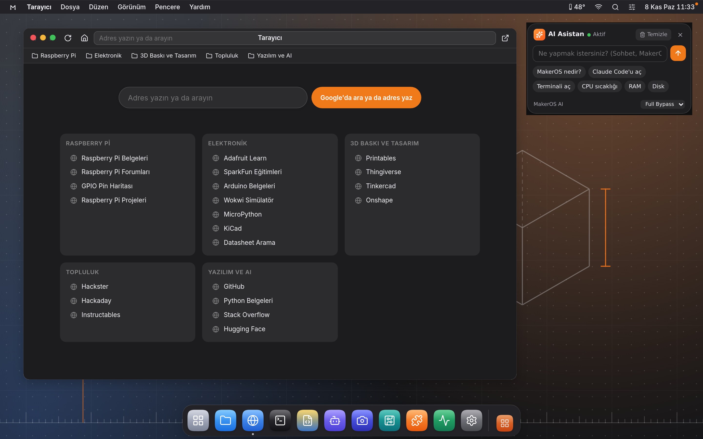
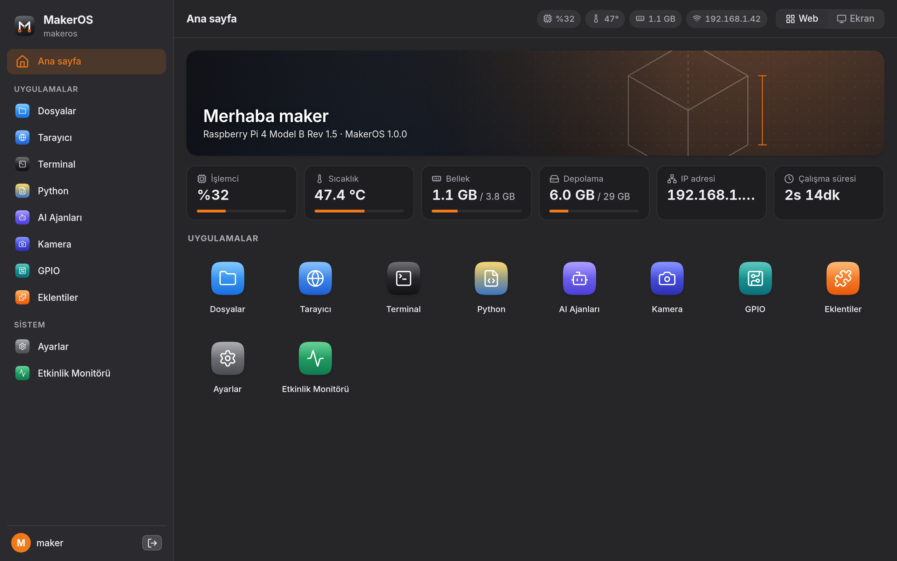
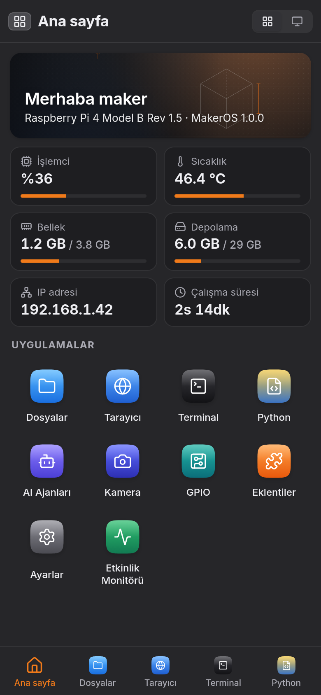
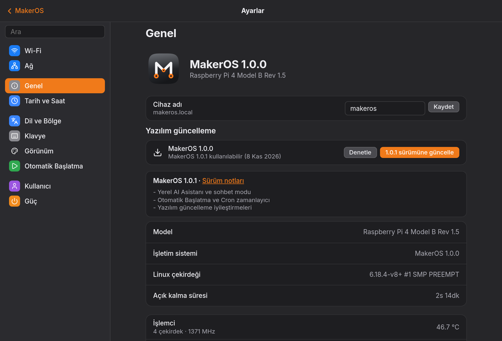
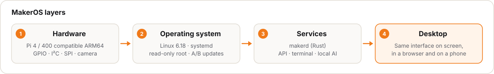
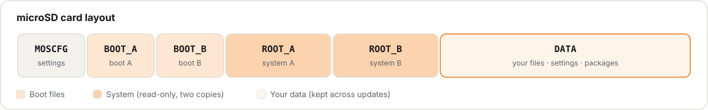
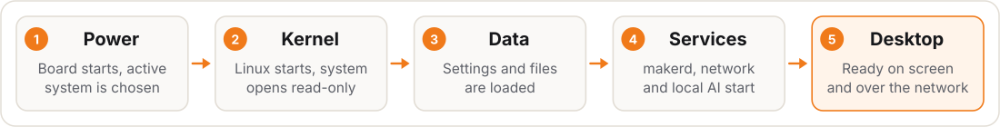
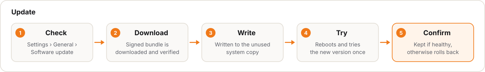
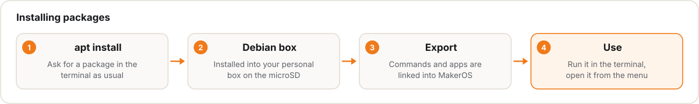

<p align="center">
  <a href="https://github.com/ferhatozcelik/maker-os">
    
  </a>
</p>

<h1 align="center">MakerOS</h1>

<p align="center">An independent, fully open-source Linux operating system for ARM64, Pi 4 compatible boards.</p>

<p align="center"><strong>Your workshop, in your pocket.</strong></p>

<p align="center">
  <a href="https://github.com/ferhatozcelik/maker-os/releases/tag/v1.0.0"></a>
  
  
  <a href="LICENSE"></a>
</p>

<p align="center">
  <a href="https://github.com/ferhatozcelik/maker-os/releases/latest">Download</a> ·
  <a href="#features">Features</a> ·
  <a href="#architecture">How it works</a> ·
  <a href="#packages">Packages</a> ·
  <a href="#setup-guide">Setup</a> ·
  <a href="#documentation">Documentation</a> ·
  <a href="docs/api.en.md">API</a> ·
  <a href="CONTRIBUTING.md">Contribute</a>
</p>

<p align="center">
  <a href="README.md">Türkçe</a> ·
  <a href="README.en.md">English</a>
</p>

<p align="center">
  <strong>Support the project</strong><br>
  <a href="https://buymeacoffee.com/ferhatozcelik">Buy Me a Coffee</a> ·
  <a href="https://thanks.dev/donations">thanks.dev</a>
</p>

<br>

<table align="center">
  <tr>
    <th align="center" colspan="2">Desktop · Browser & Local AI Assistant</th>
  </tr>
  <tr>
    <td align="center" colspan="2"></td>
  </tr>
  <tr>
    <th align="center">Web Interface</th>
    <th align="center">Mobile</th>
  </tr>
  <tr>
    <td align="center" valign="top"></td>
    <td align="center" valign="top"></td>
  </tr>
  <tr>
    <th align="center" colspan="2">Settings · General & Software Update</th>
  </tr>
  <tr>
    <td align="center" colspan="2"></td>
  </tr>
</table>

## What is MakerOS?

MakerOS is an independent, open-source Linux operating system for Pi 4 / 400 compatible ARM64 boards. Plug the board into a display and use it like a desktop computer, or use it remotely from any browser on your network or from your phone. A terminal, file manager, Python projects, GPIO, camera and an offline AI assistant come built in.

**Computing should be personal again.** MakerOS started on a small ARM board with a simple question: *"Can we design a computer that truly belongs to us?"* The goal is a system that needs no expensive hardware, that you can understand and change, and that helps you build your ideas.

> Technology should not tell you what to do — it should expand what you can build.
>
> **Your workshop, in your pocket.**

## Download

[Release 1.0.0](https://github.com/ferhatozcelik/maker-os/releases/latest): `makeros-1.0.0-rpi4.img.xz` (Pi 4 / 400 compatible boards, ARM64). Verify after download with `sha256sum -c makeros-*.img.xz.sha256`.

<a id="features"></a>

## Features

| | |
| --- | --- |
| **One desktop, everywhere** | The same interface on the board's display, in a browser on your network, and on your phone. |
| **Safe updates** | New versions install to a spare copy of the system; if anything goes wrong, the board rolls back on its own. |
| **Local AI assistant** | An assistant that works without internet; it answers questions and runs commands only with your permission. |
| **Package installs** | Debian-style `apt install`; packages go into your personal space on the microSD. |
| **Python & automation** | Python projects from ready-made templates; run them at boot or on a schedule. |
| **Hardware & camera** | Live GPIO control, I²C / SPI / UART, live video from CSI and USB cameras. |
| **Plugins & themes** | A plugin store, ready-made themes and a light, low-power look. |

<a id="architecture"></a>

## How It Works

<p align="center"></p>

| Layer | What it does |
| --- | --- |
| **1. Hardware** | The board the system runs on. Pins, sensors and the camera live here. |
| **2. Operating system** | The Linux kernel and core services. System files are read-only, so they can't be broken by accident. |
| **3. Services** | `makerd`: the background program that safely does everything the interface asks for (files, terminal, network, AI, updates). |
| **4. Desktop** | The interface you see. It is web-based, so it works the same on screen, in a browser and on a phone. |

Details: [Desktop](docs/architecture/desktop.en.md) · [Services](docs/architecture/backend.en.md) · [Local AI](docs/architecture/ai-assistant.en.md) · [Hardware](docs/architecture/hardware.en.md)

### microSD card

<p align="center"></p>

| Partition | What it does |
| --- | --- |
| **MOSCFG** | Stores which system copy to boot and optional Wi-Fi settings. You can open and edit it on your computer. |
| **BOOT_A / BOOT_B** | Files that start the board; each system copy has its own boot partition. |
| **ROOT_A / ROOT_B** | Two copies of the operating system. One is in use while the other waits for the next update. |
| **DATA** | Your space: files, settings, projects and installed packages. Updates never touch it. |

### Boot

<p align="center"></p>

1. **Power:** The board starts and picks the last working system copy (A or B).
2. **Kernel:** Linux starts; system files are mounted read-only.
3. **Data:** The `DATA` partition is checked and mounted; your settings and files come back.
4. **Services:** `makerd`, networking and the local AI start. Without a network, the board opens its own `MakerOS` Wi-Fi.
5. **Desktop:** The interface opens on screen and is reachable over the network at the same time.

### Update

<p align="center"></p>

1. **Check:** Settings › General › Software update looks for a new version.
2. **Download:** The update bundle is downloaded and its signature verified; tampered bundles are rejected.
3. **Write:** The bundle is written to the system copy that is not in use. The running system is untouched.
4. **Try:** The board boots the new version **once**.
5. **Confirm:** If all is well, the new version becomes permanent; if boot fails, the board automatically returns to the previous version.

Details: [Boot & storage](docs/architecture/boot-and-storage.en.md)

<a id="packages"></a>

## Installing Packages (`apt` / `mos pkg`)

<p align="center"></p>

Because system files are read-only, packages are installed into your **personal Debian box** on the microSD instead of the system. You won't notice the difference: commands run in the terminal and apps appear in the menu.

1. **apt install:** Ask for a package in the terminal, just like on Debian.
2. **Debian box:** The package is installed into your personal box on the `DATA` partition. The system is untouched and updates never remove it.
3. **Export:** The package's commands and apps are linked into MakerOS.
4. **Use:** Run the command in the terminal or open the app from the menu.

```bash
apt install htop      # install a package
htop                  # run it directly
apt remove htop       # remove it
mos box               # enter a full Debian shell
```

Details: [Package manager](docs/architecture/packages.en.md)

<a id="setup-guide"></a>

## Setup

1. **Flash:** Download the image from [Releases](https://github.com/ferhatozcelik/maker-os/releases/latest) and write it to a microSD card with an image writer (e.g. balenaEtcher). Optionally copy `wifi-example.txt` to `wifi.txt` on the `MOSCFG` partition and fill in your Wi-Fi details.
2. **Boot:** Insert the card and power on.
3. **Connect:** Open `http://maker-os.local/` on the same network or `http://10.55.0.1/` over USB-C; without a network, join the `MakerOS` Wi-Fi and open `http://10.42.0.1/kurulum`.
4. **Sign in:** The default account is **`makeros` / `makeros`**. Change the password in **Settings › User**.

<a id="documentation"></a>

## Documentation

All documents are available in English and Turkish. Start here: [`docs/`](docs/README.en.md)

| Topic | English | Türkçe |
| --- | --- | --- |
| Overview | [overview.en.md](docs/architecture/overview.en.md) | [overview.md](docs/architecture/overview.md) |
| Boot & storage | [boot-and-storage.en.md](docs/architecture/boot-and-storage.en.md) | [boot-and-storage.md](docs/architecture/boot-and-storage.md) |
| Desktop | [desktop.en.md](docs/architecture/desktop.en.md) | [desktop.md](docs/architecture/desktop.md) |
| Services (Rust) | [backend.en.md](docs/architecture/backend.en.md) | [backend.md](docs/architecture/backend.md) |
| Package manager | [packages.en.md](docs/architecture/packages.en.md) | [packages.md](docs/architecture/packages.md) |
| Local AI assistant | [ai-assistant.en.md](docs/architecture/ai-assistant.en.md) | [ai-assistant.md](docs/architecture/ai-assistant.md) |
| Network & security | [network-security.en.md](docs/architecture/network-security.en.md) | [network-security.md](docs/architecture/network-security.md) |
| Hardware | [hardware.en.md](docs/architecture/hardware.en.md) | [hardware.md](docs/architecture/hardware.md) |
| Build & test | [build-and-test.en.md](docs/development/build-and-test.en.md) | [build-and-test.md](docs/development/build-and-test.md) |
| Validation status | [validation.en.md](docs/verification/validation.en.md) | [validation.md](docs/verification/validation.md) |
| Branding & licensing | [branding-and-licensing.en.md](docs/project/branding-and-licensing.en.md) | [branding-and-licensing.md](docs/project/branding-and-licensing.md) |
| HTTP/WS API | [api.en.md](docs/api.en.md) | [api.md](docs/api.md) |

<a id="build-from-source"></a>

## Build from Source

```bash
make -C makerd preview     # preview on your computer → http://localhost:8080/
make -C shell smoke        # interface tests
./os/build.sh build        # build the microSD image → os/out/
```

Source directories: [`os/`](os/README.md) (operating system and image) · [`makerd/`](makerd/) (services) · [`shell/`](shell/README.md) (desktop) · [`site/`](site/index.html) ([project website](https://ferhatozcelik.github.io/maker-os/)). Details: [Build & test](docs/development/build-and-test.en.md) · [Validation status](docs/verification/validation.en.md)

## License

[MIT](LICENSE). Third-party components: [`NOTICE.md`](NOTICE.md).

MakerOS is an independent open-source project, not affiliated with any hardware or software vendor. Product names are trademarks of their respective owners.
