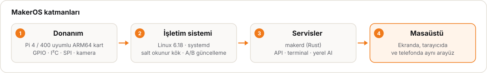
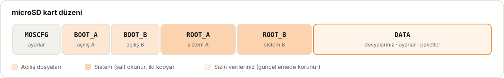
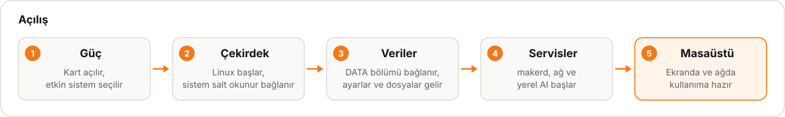
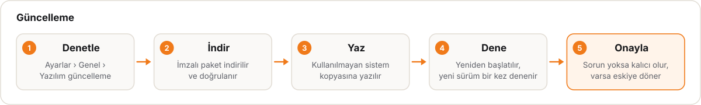
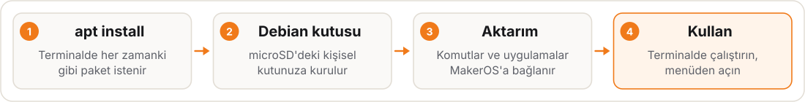
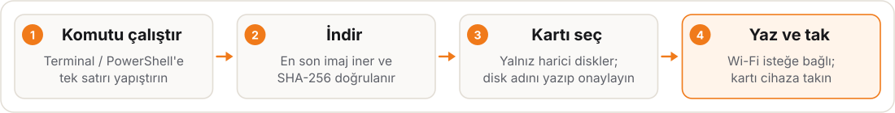
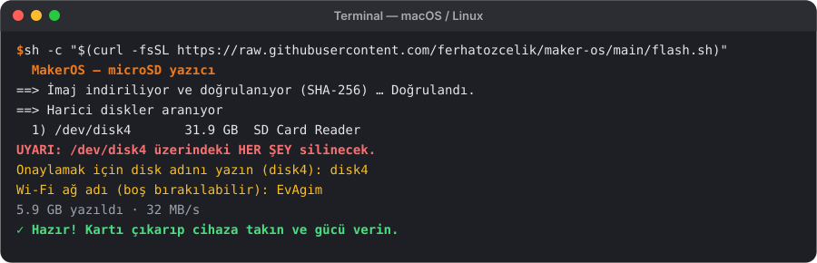
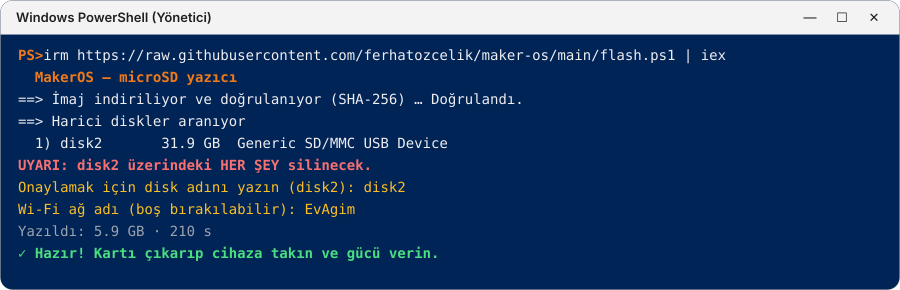

<p align="center">
  <a href="https://github.com/ferhatozcelik/maker-os">
    
  </a>
</p>

<h1 align="center">MakerOS</h1>

<p align="center">ARM64 tabanlı, Pi 4 uyumlu kartlarda çalışan bağımsız ve tamamen açık kaynaklı Linux işletim sistemi.</p>

<p align="center"><strong>Atölyen cebinde.</strong> · <em>Your workshop, in your pocket.</em></p>

<p align="center">
  <a href="https://github.com/ferhatozcelik/maker-os/releases/tag/v1.0.0"></a>
  
  
  <a href="LICENSE"></a>
</p>

<p align="center">
  <a href="https://github.com/ferhatozcelik/maker-os/releases/latest">İndir</a> ·
  <a href="#features">Özellikler</a> ·
  <a href="#architecture">Nasıl çalışır?</a> ·
  <a href="#packages">Paketler</a> ·
  <a href="#setup-guide">Kurulum</a> ·
  <a href="#documentation">Dokümantasyon</a> ·
  <a href="docs/api.md">API</a> ·
  <a href="CONTRIBUTING.md">Katkıda bulun</a>
</p>

<p align="center">
  <a href="README.md">Türkçe</a> ·
  <a href="README.en.md">English</a>
</p>

<p align="center">
  <strong>Projeyi destekleyin</strong><br>
  <a href="https://buymeacoffee.com/ferhatozcelik">Buy Me a Coffee</a> ·
  <a href="https://thanks.dev/donations">thanks.dev</a>
</p>

<br>

<table align="center">
  <tr>
    <th align="center" colspan="2">Masaüstü · Tarayıcı ve Yerel AI Asistanı</th>
  </tr>
  <tr>
    <td align="center" colspan="2"></td>
  </tr>
  <tr>
    <th align="center">Web arayüzü</th>
    <th align="center">Telefon</th>
  </tr>
  <tr>
    <td align="center" valign="top"></td>
    <td align="center" valign="top"></td>
  </tr>
  <tr>
    <th align="center" colspan="2">Ayarlar · Genel ve Yazılım Güncelleme</th>
  </tr>
  <tr>
    <td align="center" colspan="2"></td>
  </tr>
</table>

## Nedir?

MakerOS, Pi 4 / 400 uyumlu ARM64 kartlar için hazırlanmış bağımsız ve açık kaynaklı bir Linux işletim sistemidir. Kartı bir ekrana bağlayarak masaüstü bilgisayar gibi, ya da ağdaki herhangi bir tarayıcıdan veya telefondan uzaktan kullanabilirsiniz. Terminal, dosyalar, Python projeleri, GPIO, kamera ve internetsiz çalışan bir yapay zekâ asistanı hazır gelir.

**Bilgisayar yeniden kişisel olmalı.** MakerOS, *"Bir bilgisayarı gerçekten kendimiz için tasarlayabilir miyiz?"* sorusuyla küçük bir ARM kart üzerinde doğdu. Amaç; pahalı donanım gerektirmeyen, nasıl çalıştığını anlayabildiğiniz, değiştirebildiğiniz ve fikirlerinizi hayata geçirebildiğiniz bir sistem.

> Teknoloji kullanıcıya ne yapacağını söylememeli; kullanıcının ne yapabileceğini genişletmeli.
>
> **Atölyen cebinde.** — *Your workshop, in your pocket.*

## İndir

[Sürüm 1.0.0](https://github.com/ferhatozcelik/maker-os/releases/latest): `makeros-1.0.0-rpi4.img.xz` (Pi 4 / 400 uyumlu kartlar, ARM64). En kolay yol: [Kurulum](#setup-guide) bölümündeki tek satırlık komut imajı indirip doğrular ve karta yazar.

<a id="features"></a>

## Özellikler

| Özellik | Açıklama |
| --- | --- |
| **Her yerden aynı masaüstü** | Kartın ekranında, ağdaki bir bilgisayarın tarayıcısında ve telefonda aynı arayüz. |
| **Güvenli güncelleme** | Yeni sürüm sistemin yedek kopyasına kurulur; bir sorun olursa kart kendiliğinden eski sürüme döner. |
| **Yerel AI asistanı** | İnternet gerektirmeyen Türkçe asistan; soruları yanıtlar, izin verirseniz komut çalıştırır. |
| **Paket kurma** | Debian'daki gibi `apt install`; paketler microSD'deki kişisel alanınıza kurulur. |
| **Python ve otomasyon** | Hazır şablonlarla Python projeleri; açılışta ya da belirli saatlerde otomatik çalıştırma. |
| **Donanım ve kamera** | GPIO pinlerini canlı kontrol, I²C / SPI / UART, CSI ve USB kameradan canlı görüntü. |
| **Eklentiler ve temalar** | Eklenti mağazası, hazır temalar ve düşük güç tüketen sade görünüm. |

<a id="architecture"></a>

## Nasıl Çalışır?

<p align="center"></p>

| Katman | Ne işe yarar? |
| --- | --- |
| **1. Donanım** | Sistemin çalıştığı kart. Pinler, sensörler ve kamera bu katmandadır. |
| **2. İşletim sistemi** | Linux çekirdeği ve temel servisler. Sistem dosyaları salt okunurdur, yanlışlıkla bozulmaz. |
| **3. Servisler** | `makerd`: arayüzün istediği her şeyi (dosyalar, terminal, ağ, AI, güncelleme) güvenli biçimde yapan arka plan programı. |
| **4. Masaüstü** | Gördüğünüz arayüz. Web tabanlıdır, bu yüzden ekranda, tarayıcıda ve telefonda aynı şekilde çalışır. |

Ayrıntılar: [Masaüstü](docs/architecture/desktop.md) · [Servisler](docs/architecture/backend.md) · [Yerel AI](docs/architecture/ai-assistant.md) · [Donanım](docs/architecture/hardware.md)

### microSD kart

<p align="center"></p>

| Bölüm | Ne işe yarar? |
| --- | --- |
| **MOSCFG** | Hangi sistem kopyasıyla açılacağını ve isteğe bağlı Wi-Fi ayarını tutar. Bilgisayarınızda açıp düzenleyebilirsiniz. |
| **BOOT_A / BOOT_B** | Kartı açan dosyalar; her sistem kopyasının kendi açılış bölümü vardır. |
| **ROOT_A / ROOT_B** | İşletim sisteminin iki kopyası. Biri kullanılırken diğeri güncellemeye hazır bekler. |
| **DATA** | Sizin alanınız: dosyalar, ayarlar, projeler ve kurduğunuz paketler. Güncellemeler bu bölüme dokunmaz. |

### Açılış

<p align="center"></p>

1. **Güç:** Kart açılır ve son çalışan sistem kopyası (A ya da B) seçilir.
2. **Çekirdek:** Linux başlar; sistem dosyaları değiştirilemez (salt okunur) olarak açılır.
3. **Veriler:** `DATA` bölümü denetlenip bağlanır; ayarlarınız ve dosyalarınız yerine gelir.
4. **Servisler:** `makerd`, ağ bağlantısı ve yerel AI başlar. Ağ yoksa kart kendi `MakerOS` Wi-Fi'ını açar.
5. **Masaüstü:** Arayüz ekranda açılır; aynı anda ağdan da erişilebilir.

### Güncelleme

<p align="center"></p>

1. **Denetle:** Ayarlar › Genel › Yazılım güncelleme yeni sürüm olup olmadığına bakar.
2. **İndir:** Güncelleme paketi indirilir; imzası doğrulanır, değiştirilmiş paket kurulmaz.
3. **Yaz:** Paket, o an kullanılmayan sistem kopyasına yazılır. Çalışan sistem etkilenmez.
4. **Dene:** Kart yeni sürümle **bir kez** açılır.
5. **Onayla:** Her şey yolundaysa yeni sürüm kalıcı olur; açılış başarısızsa kart otomatik olarak eski sürüme döner.

Ayrıntılar: [Önyükleme ve depolama](docs/architecture/boot-and-storage.md)

<a id="packages"></a>

## Paket Kurma (`apt` / `mos pkg`)

<p align="center"></p>

Sistem dosyaları salt okunur olduğu için paketler sisteme değil, microSD'deki **kişisel Debian kutunuza** kurulur. Siz farkı görmezsiniz: komut terminalde çalışır, uygulama menüde görünür.

1. **apt install:** Terminalde Debian'daki gibi paket istersiniz.
2. **Debian kutusu:** Paket, `DATA` bölümündeki kişisel kutunuza kurulur. Sisteme dokunmaz, güncellemelerde silinmez.
3. **Aktarım:** Paketin komutları ve uygulamaları MakerOS'a bağlanır.
4. **Kullan:** Komutu terminalde çalıştırın, uygulamayı menüden açın.

```bash
apt install htop      # paketi kur
htop                  # doğrudan çalıştır
apt remove htop       # kaldır
mos box               # tam Debian kabuğuna gir
```

Ayrıntılar: [Paket yöneticisi](docs/architecture/packages.md)

<a id="setup-guide"></a>

## Kurulum

### 1. microSD karta yazın

<p align="center"></p>

Tek satırlık komut en son imajı indirir, doğrular, yalnız harici diskleri listeler ve seçtiğiniz karta yazar. İsterseniz Wi-Fi bilgilerinizi de karta ekler; kart ilk açılışta ağınıza kendiliğinden bağlanır.

**macOS / Linux** — Terminal'i açıp yapıştırın:

```bash
sh -c "$(curl -fsSL https://raw.githubusercontent.com/ferhatozcelik/maker-os/main/flash.sh)"
```

<p align="center"></p>

**Windows** — Başlat menüsünde *PowerShell*'e sağ tıklayıp **Yönetici olarak çalıştır**'ı seçin ve yapıştırın (ya da [`flash.cmd`](flash.cmd) dosyasını indirip çift tıklayın):

```powershell
irm https://raw.githubusercontent.com/ferhatozcelik/maker-os/main/flash.ps1 | iex
```

<p align="center"></p>

| Adım | Ne olur? |
| --- | --- |
| **1. Komutu çalıştır** | Betik GitHub'dan çalışır; ayrıca bir program kurmanız gerekmez. |
| **2. İndir** | En son sürüm indirilir ve SHA-256 özeti doğrulanır. Bozuk ya da değiştirilmiş dosya yazılmaz. |
| **3. Kartı seç** | Yalnız harici / çıkarılabilir diskler listelenir. Bilgisayarınızın diski asla gösterilmez; yazmadan önce disk adını (ör. `disk4`) yazarak onaylarsınız. |
| **4. Yaz ve tak** | İmaj karta yazılır, Wi-Fi bilgisi verdiyseniz `wifi.txt` eklenir ve kart çıkarılmaya hazır olur. |

> Windows kartı yazdıktan sonra "biçimlendirilsin mi?" diye sorarsa **İptal**'e basın. Elle yazmak isterseniz [sürüm sayfasındaki](https://github.com/ferhatozcelik/maker-os/releases/latest) `.img.xz` dosyasını balenaEtcher gibi bir araçla da yazabilirsiniz.

### 2. Başlatın ve bağlanın

1. **Başlatın:** Kartı cihaza takıp gücü verin. İlk açılış bir iki dakika sürer.
2. **Bağlanın:** Aynı ağda `http://maker-os.local/`, USB-C ile `http://10.55.0.1/`; ağ yoksa `MakerOS` Wi-Fi'ına bağlanıp `http://10.42.0.1/kurulum` adresini açın.
3. **Oturum açın:** Varsayılan hesap **`makeros` / `makeros`**. Parolayı **Ayarlar › Kullanıcı** bölümünden değiştirin.

<a id="documentation"></a>

## Dokümantasyon

Tüm belgeler Türkçe ve İngilizcedir. Giriş sayfası: [`docs/`](docs/README.md)

| Konu | Türkçe | English |
| --- | --- | --- |
| Genel bakış | [overview.md](docs/architecture/overview.md) | [overview.en.md](docs/architecture/overview.en.md) |
| Önyükleme ve depolama | [boot-and-storage.md](docs/architecture/boot-and-storage.md) | [boot-and-storage.en.md](docs/architecture/boot-and-storage.en.md) |
| Masaüstü | [desktop.md](docs/architecture/desktop.md) | [desktop.en.md](docs/architecture/desktop.en.md) |
| Servisler (Rust) | [backend.md](docs/architecture/backend.md) | [backend.en.md](docs/architecture/backend.en.md) |
| Paket yöneticisi | [packages.md](docs/architecture/packages.md) | [packages.en.md](docs/architecture/packages.en.md) |
| Yerel AI asistanı | [ai-assistant.md](docs/architecture/ai-assistant.md) | [ai-assistant.en.md](docs/architecture/ai-assistant.en.md) |
| Ağ ve güvenlik | [network-security.md](docs/architecture/network-security.md) | [network-security.en.md](docs/architecture/network-security.en.md) |
| Donanım | [hardware.md](docs/architecture/hardware.md) | [hardware.en.md](docs/architecture/hardware.en.md) |
| Derleme ve test | [build-and-test.md](docs/development/build-and-test.md) | [build-and-test.en.md](docs/development/build-and-test.en.md) |
| Doğrulama durumu | [validation.md](docs/verification/validation.md) | [validation.en.md](docs/verification/validation.en.md) |
| Marka ve lisans | [branding-and-licensing.md](docs/project/branding-and-licensing.md) | [branding-and-licensing.en.md](docs/project/branding-and-licensing.en.md) |
| HTTP/WS API | [api.md](docs/api.md) | [api.en.md](docs/api.en.md) |

<a id="build-from-source"></a>

## Kaynaktan Derleme

```bash
make -C makerd preview     # bilgisayarınızda önizleme → http://localhost:8080/
make -C shell smoke        # arayüz testleri
./os/build.sh build        # microSD imajını derle → os/out/
```

Kaynak dizinleri: [`os/`](os/README.md) (işletim sistemi ve imaj) · [`makerd/`](makerd/) (servisler) · [`shell/`](shell/README.md) (masaüstü) · [`site/`](site/index.html) ([tanıtım sayfası](https://ferhatozcelik.github.io/maker-os/)). Ayrıntılar: [Derleme ve test](docs/development/build-and-test.md) · [Doğrulama durumu](docs/verification/validation.md)

## Lisans

[MIT](LICENSE). Üçüncü taraf bileşenler: [`NOTICE.md`](NOTICE.md).

MakerOS bağımsız bir açık kaynak projesidir; herhangi bir donanım ya da yazılım üreticisiyle bağı yoktur. Anılan ürün adları sahiplerinin markalarıdır.
