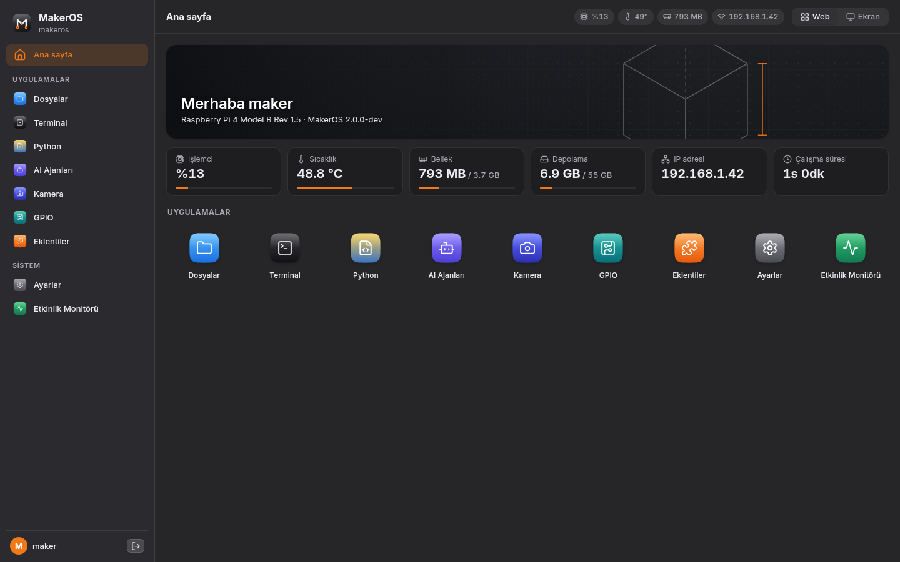
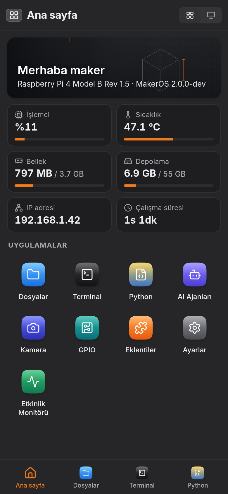
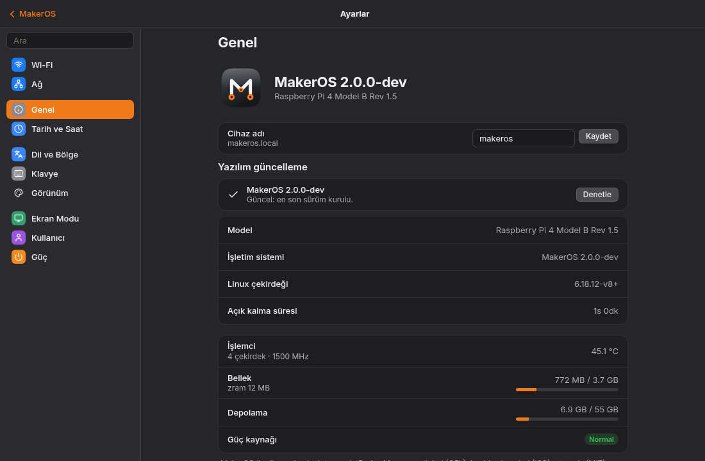

<p align="center">
  <a href="https://github.com/ferhatozcelik/maker-os">
    
  </a>
</p>

<h1 align="center">MakerOS</h1>

<p align="center">Raspberry Pi için maker işletim sistemi: öğrenciler, yapıcılar ve yapay zekâ projeleri.</p>

<p align="center"><strong>SD karta yaz. Pi'yi aç. Tarayıcıdan bağlan.</strong></p>

<p align="center">
  <a href="https://github.com/ferhatozcelik/maker-os/releases/latest"></a>
  
  
  <a href="LICENSE"></a>
</p>

<p align="center">
  <a href="https://github.com/ferhatozcelik/maker-os/releases/latest">İndir</a> ·
  <a href="#kurulum">Kurulum</a> ·
  <a href="#özellikler">Özellikler</a> ·
  <a href="#kaynaktan-derleme">Kaynaktan derleme</a> ·
  <a href="docs/v2/api.md">API</a> ·
  <a href="CONTRIBUTING.md">Katkı</a>
</p>

<p align="center">
  <a href="README.md">Türkçe</a> ·
  <a href="README.en.md">English</a>
</p>

<br>

<table align="center">
  <tr><th align="center" colspan="2">Masaüstü: Chromium penceresi (tarayıcıda)</th></tr>
  <tr><td align="center" colspan="2"></td></tr>
  <tr>
    <th align="center">Web arayüzü</th>
    <th align="center">Telefon</th>
  </tr>
  <tr>
    <td align="center" valign="top"></td>
    <td align="center" valign="top"></td>
  </tr>
  <tr><th align="center" colspan="2">Yazılım güncelleme</th></tr>
  <tr><td align="center" colspan="2"></td></tr>
</table>

Görüntüler güncel derlemenin Docker ortamında çekilmiştir; sıcaklık, bellek ve ağ gibi cihaz
bilgileri örnek veridir. Kamera, Wi-Fi ve GPIO'nun donanım testleri Raspberry Pi gerektirir.

## İndir

[Son sürüm](https://github.com/ferhatozcelik/maker-os/releases/latest): `makeros-<sürüm>-rpi4.img.xz`
(Raspberry Pi 4 / 400, 64 bit). İndirdikten sonra `sha256sum -c makeros-*.img.xz.sha256` ile doğrulayın.

## Özellikler

| Alan | İçerik |
| --- | --- |
| Taban | Buildroot ile Linux 6.18 (Raspberry Pi) üzerine kurulan bağımsız sistem; salt okunur EROFS kök dosya sistemi, A/B bölümleri, systemd |
| İki görünüm | Tek adres (`http://makeros.local/`): pencereli **Ekran** (masaüstü, raf, pencereler) ve telefona uygun **Web** arayüzü; üstteki *Web \| Ekran* düğmesiyle geçiş. Ana ekrana eklenebilir (PWA) |
| Chromium | Masaüstünde normal bir pencere: Pi'de çalışan gerçek tarayıcı, ayrı ve görünmez bir ekranda çizilir, yalnız o pencere aktarılır; pencereyle birlikte boyutlanır, kapanınca durur |
| Dosyalar ve terminal | Dosya yükleme/indirme; `.py` dosyasına tıklayınca çalışır. Web terminali Pi'nin ekranıyla aynı oturumu paylaşır, telefon için ek tuşlar |
| Python | uv ile sanal ortamlı projeler ve Python sürümleri; şablonlar: LED, buton, I2C tarayıcı, kamera, web, yapay zekâ nesne tespiti |
| AI ajanları | Claude Code, Codex CLI, Gemini CLI, OpenCode ve Ollama (yerel modeller): kur, güncelle, başlat |
| Donanım | GPIO (40 pin), I2C, SPI, UART; Pi kamera ve USB kamera (libcamera) |
| Eklentiler | Python eklentileri, zip içe/dışa aktarma, şablon; eklentiyle tema, menü çubuğu göstergesi ve masaüstü kartı |
| Yazılım güncelleme | Ayarlar › Genel: yeni sürüm GitHub'dan bulunur; imzalı paket indirilir, doğrulanır, boştaki bölüme kurulur. Yeni sürüm açılamazsa Pi önceki sürüme kendiliğinden döner; dosyalar ve ayarlar korunur |
| Ağ | Ethernet, Wi-Fi, gizli ağ, WPA2-Enterprise; ağ yoksa şifresiz `MakerOS` kurulum ağı ve kurulum sayfası |
| İzleme | Etkinlik Monitörü: CPU, bellek, sıcaklık, işlemler |
| Temalar | Maker, Hackerspace, Donanım, Siber güvenlik, 3B baskı; açık/koyu görünüm, vurgu rengi |

## Kurulum

1. [Son sürümden](https://github.com/ferhatozcelik/maker-os/releases/latest) `makeros-<sürüm>-rpi4.img.xz`
   dosyasını indirin.
2. Raspberry Pi Imager ile SD karta yazın (*Use custom* / *Özel imaj kullan*). Imager'ın "işletim
   sistemi özelleştirme" ayarları MakerOS'ta kullanılmaz.
3. *(İsteğe bağlı)* Kartın `MOSCFG` bölümündeki `wifi-example.txt` dosyasını `wifi.txt` adıyla
   kopyalayıp ağ adını ve parolasını yazın. İlk açılışta okunur ve güvenlik için silinir.
4. Pi'yi açın ve bir tarayıcıdan **http://makeros.local/** adresine gidin. Kablo ya da `wifi.txt`
   yoksa telefonunuzu `MakerOS` Wi-Fi ağına bağlayın; kurulum sayfası açılır (açılmazsa
   `http://10.42.0.1/kurulum`).
5. İlk açılış sihirbazında bölge ve klavyeyi, gerekirse Wi-Fi ağını seçin; hesabınızı ve cihaz
   adını belirleyin. Varsayılan parola yoktur; ilk hesap yöneticidir.

**Donanım:** Raspberry Pi 4 Model B ve Raspberry Pi 400. A/B güncellemesi için Pi önyükleyici
(EEPROM) sürümü 2025-03 veya yenisi gerekir.

## Doğrulama durumu

Arayüz, makerd ve Chromium penceresi **Docker içinde**, derlenmiş kök dosya sistemiyle uçtan uca
test edilmiştir. Gerçek Raspberry Pi donanımında ölçülmüş performans verisi henüz yoktur; Docker'daki
karşılaştırma için bkz. [docs/v2/BENCHMARK.md](docs/v2/BENCHMARK.md). İmzalı güncellemenin donanımdaki
güç kesintisi ve bozuk paket testleri ilk sürümlerde sürmektedir. Sorunları
[Issues](https://github.com/ferhatozcelik/maker-os/issues) sayfasına bildirin.

## Kaynaktan derleme

Tüm derleme ve testler Docker içinde çalışır; ana makineye araç kurulmaz.

```bash
./os/run-docker.sh                    # derlenmiş kök dosya sistemini Docker'da çalıştır → http://localhost/
docker-compose up -d --build          # yalın önizleme: makerd (örnek veri) + kabuk → http://localhost/
make -C makerd test                   # makerd testleri
make -C shell smoke                   # kabuk duman testi (başsız Chromium)
./os/build.sh build                   # Raspberry Pi imajı → os/out/makeros-<sürüm>-rpi4.img.xz
```

Chromium paketi derlemeden önce bir kez hazırlanır:
`docker run --rm -v "$PWD/os/chromium":/s:ro -v "$PWD/os/out":/out debian:trixie sh /s/build-bundle.sh`

İmzalı güncelleme paketi (`.raucb`) yalnız imza anahtarı varsa üretilir (`os/keys/rauc-key.pem`,
depoya girmez). Sürümler GitHub Actions ile yayınlanır: `os/VERSION` artırılıp `main`'e
gönderildiğinde imaj ve paket derlenir, Release oluşturulur
([.github/workflows/release.yml](.github/workflows/release.yml)).

| Klasör | İçerik |
|---|---|
| `os/` | Buildroot dış ağacı: defconfig, kart dosyaları, paketler, imaj betikleri |
| `makerd/` | Arka uç hizmeti (Go): API, terminal, dosyalar, yazılım güncelleme, Chromium oturumu |
| `shell/` | Web kabuğu: masaüstü, Web arayüzü, uygulamalar (bağımlılıksız JS) |
| `docs/v2/` | Plan, API, yol haritası, karşılaştırma, ekran görüntüleri |
| `bench/` | Karşılaştırma betikleri ve ham veriler |
| `makerd-rs/`, `wm/` | Uzun vadeli Rust çalışmaları (henüz imajda kullanılmıyor) |

## Lisans ve marka açıklaması

MakerOS için bu depoda geliştirilen özgün kaynak kodu, derleme betikleri, yapılandırmalar ve
örnekler **GNU Genel Kamu Lisansı sürüm 3 veya sonraki herhangi bir sürüm**
(`GPL-3.0-or-later`) kapsamında sunulur; bkz. [`LICENSE`](LICENSE).

Bu lisans, imajdaki bütün yazılımların aynı lisansa sahip olduğu anlamına gelmez. Linux çekirdeği,
Raspberry Pi açılış yazılımı, Chromium, WPE WebKit, Mesa ve diğer üçüncü taraf bileşenler kendi hak
sahiplerine ve lisanslarına tabidir. Bileşen listesi ve kaynak bağlantıları
[`NOTICE.md`](NOTICE.md) dosyasındadır. Yeniden dağıtımda ilgili lisans ve telif bildirimleri
korunmalı; kaynak kodu sağlama yükümlülükleri bileşen ve dağıtım biçimine göre yerine
getirilmelidir.

**MakerOS bağımsız bir topluluk projesidir.** Raspberry Pi Ltd adına geliştirilmez; bir ortaklık,
sponsorluk, sertifikasyon, onay veya resmî destek ilişkisi iddia edilmez.
**Raspberry Pi is a trademark of Raspberry Pi Ltd.** Bu belgelerdeki marka atıfları yalnız hedef
donanımı tanımlamak içindir; yazılım lisansı marka veya logo kullanım izni vermez. Bkz.
[Raspberry Pi marka kuralları](https://www.raspberrypi.com/trademark-rules/). Varsayılan eklentideki
Konya HackerSpace adı ve işaretine ilişkin haklar Konya HackerSpace'e aittir.

Yazılım, yürürlükteki hukukun izin verdiği ölçüde, lisanslarda belirtilen şekilde **olduğu gibi ve
garanti verilmeksizin** sunulur. Bu açıklama hukuki uygunluk belgesi değildir.
