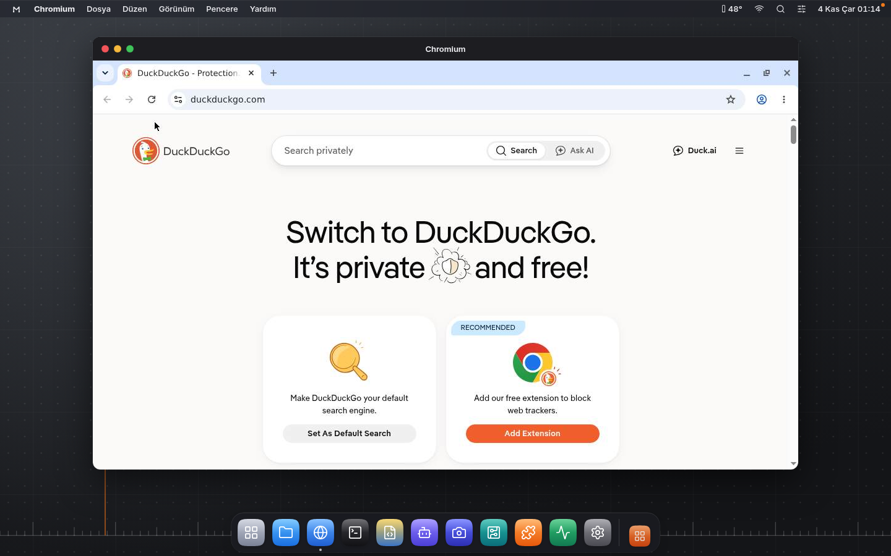
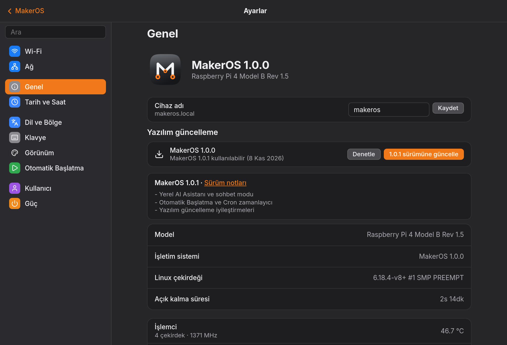

<p align="center">
  <a href="https://github.com/ferhatozcelik/maker-os">
    
  </a>
</p>

<h1 align="center">MakerOS</h1>

<p align="center">Raspberry Pi için bağımsız maker işletim sistemi: öğrenciler, yapıcılar ve yapay zekâ projeleri.</p>

<p align="center"><strong>SD karta yazın. Pi’yi açın. Tarayıcıdan bağlanın.</strong></p>

<p align="center">
  <a href="https://github.com/ferhatozcelik/maker-os/releases/tag/v2.0.0"></a>
  
  
  <a href="LICENSE"></a>
</p>

<p align="center">
  <a href="https://github.com/ferhatozcelik/maker-os/releases/latest">İndir</a> ·
  <a href="#setup-guide">Kurulum rehberi</a> ·
  <a href="#features">Özellikler</a> ·
  <a href="#build-from-source">Kaynaktan derleme</a> ·
  <a href="docs/api.md">API</a> ·
  <a href="CONTRIBUTING.md">Katkıda bulun</a>
</p>

<p align="center">
  <a href="README.md">Türkçe</a> ·
  <a href="README.en.md">English</a>
</p>

<p align="center">
  <strong>Projeyi destekleyin</strong><br>
  <a href="https://buymeacoffee.com/ferhatozcelik">Buy Me a Coffee</a> ·
  <a href="https://thanks.dev/donations">thanks.dev</a>
</p>

<br>

<table align="center">
  <tr>
    <th align="center" colspan="2">Masaüstü · Chromium penceresi (tarayıcıda)</th>
  </tr>
  <tr>
    <td align="center" colspan="2"></td>
  </tr>
  <tr>
    <th align="center">Web arayüzü</th>
    <th align="center">Telefon</th>
  </tr>
  <tr>
    <td align="center" valign="top"></td>
    <td align="center" valign="top"></td>
  </tr>
  <tr>
    <th align="center" colspan="2">Ayarlar · Yazılım güncelleme</th>
  </tr>
  <tr>
    <td align="center" colspan="2"></td>
  </tr>
</table>

## Teknik dokümantasyon

Mimariyi ve teknik ayrıntıları konu başlıklarına göre incelemek için [dokümantasyon ağacına](docs/README.md) gidin:

- [Sistem mimarisi](docs/architecture/overview.md)
- [Açılış zinciri ve depolama](docs/architecture/boot-and-storage.md)
- [Masaüstü ve web kabuğu](docs/architecture/desktop.md)
- [Rust arka uç ve API](docs/architecture/backend.md)
- [Ağ ve güvenlik](docs/architecture/network-security.md)
- [Donanım ve çevre birimleri](docs/architecture/hardware.md)
- [Derleme ve test](docs/development/build-and-test.md)
- [Doğrulama durumu](docs/verification/validation.md)
- [Marka ve lisans](docs/project/branding-and-licensing.md)

English: [Documentation index](docs/README.en.md).

## İndir

[Sürüm 2.0.0](https://github.com/ferhatozcelik/maker-os/releases/latest): `makeros-2.0.0-rpi4.img.xz` (Raspberry Pi 4 / 400, 64 bit). İndirdikten sonra `sha256sum -c makeros-*.img.xz.sha256` ile doğrulayın.

## Klasörler

| Bileşen | Klasör |
| --- | --- |
| İşletim sistemi (Buildroot dış ağacı, çekirdek, paketler, imaj) | [`os/`](os/) |
| Arka uç hizmeti (Rust: API, terminal, dosyalar, eklenti mağazası, OTA, Chromium oturumu) | [`makerd/`](makerd/) |
| Web masaüstü kabuğu ve sistem uygulamaları (bağımlılıksız ES modülleri) | [`shell/`](shell/) |
| Teknik dokümantasyon (mimari, geliştirme, doğrulama, API) | [`docs/`](docs/README.md) |

```bash
make -C makerd preview                # yerel önizleme: makerd (örnek veri) + kabuk → http://localhost/
make -C makerd test                   # makerd birim ve entegrasyon testleri
make -C shell smoke                   # kabuk duman testi (başsız Chromium)
./os/build.sh build                   # Raspberry Pi imajı → os/out/makeros-<sürüm>-rpi4.img.xz
```

<a id="features"></a>

## Özellikler

| Alan | İçerik |
| --- | --- |
| Taban | Buildroot ile Linux 6.18 (Raspberry Pi) üzerine kurulan bağımsız sistem; salt okunur EROFS kök dosya sistemi, A/B bölümleri, systemd |
| İki görünüm | Tek adres (`http://maker-os.local/`): pencereli **Ekran** (masaüstü, raf, pencereler) ve telefona uygun **Web** arayüzü; üstteki *Web \| Ekran* düğmesiyle geçiş. Ana ekrana eklenebilir (PWA) |
| Chromium | Masaüstünde normal bir pencere: Pi’de çalışan gerçek tarayıcı, ayrı ve görünmez bir ekranda çizilir, yalnız o pencere aktarılır; pencereyle birlikte boyutlanır, kapanınca durur |
| Dosyalar ve terminal | Dosya yükleme ve indirme; `.py` dosyasına tıklayınca çalışır. Web terminali Pi’nin ekranıyla aynı oturumu paylaşır, telefon için ek tuş çubuğu sunar |
| Python | `uv` ile sanal ortamlı projeler ve Python sürümleri; hazır şablonlar: LED, buton, I2C tarayıcı, kamera, web, yapay zekâ nesne tespiti |
| AI ajanları ve Yerel Asistan | **makeros-ai** (Qwen2.5-0.5B + `llama.cpp` ile internetsiz Türkçe Linux asistanı, risk sınıflandırmalı komut çalıştırma ve masaüstü AI Asistan widget'ı); Claude Code, Codex CLI, Gemini CLI, OpenCode ve Ollama: tek tıklamayla kur, güncelle, başlat |
| Donanım | GPIO (40 pin), I2C, SPI, UART; Pi kamera ve USB kamera (`libcamera`) |
| Eklentiler ve Mağaza | Python eklentileri, **Eklenti Mağazası** ([`makeros-plugins`](https://github.com/ferhatozcelik/makeros-plugins) deposundan tek tıkla kurulum ve güncelleme), zip içe/dışa aktarma, hazır şablon; eklentiyle tema, menü çubuğu göstergesi ve masaüstü/web kartı (widget) ekleme |
| Yazılım güncelleme | Ayarlar › Genel: yeni sürüm GitHub’dan bulunur; imzalı RAUC paketi indirilir, doğrulanır, boştaki bölüme kurulur. Yeni sürüm açılamazsa Pi önceki sürüme kendiliğinden döner; dosyalar ve ayarlar korunur |
| Ağ | Ethernet, Wi-Fi, gizli ağ, WPA2-Enterprise; ağ yoksa şifresiz `MakerOS` kurulum ağı ve kurulum sayfası |
| İzleme | Etkinlik Monitörü: CPU, bellek, sıcaklık ve süreç yönetimi |
| Temalar | Maker, Hackerspace, Donanım, Siber güvenlik, 3B baskı; açık/koyu görünüm ve vurgu rengi |

<a id="setup-guide"></a>

## Kurulum rehberi

MakerOS, Raspberry Pi 4 Model B ve Raspberry Pi 400 (64 bit) üzerinde çalışır. Monitörle doğrudan veya ekransız (yalnızca ağ ve tarayıcı üzerinden) kullanılabilir.

### 1. İmajı SD karta yazın

1. [Sürüm sayfasından](https://github.com/ferhatozcelik/maker-os/releases/latest) `makeros-<sürüm>-rpi4.img.xz` dosyasını indirin.
2. Raspberry Pi Imager uygulamasını açın, **Use custom** (*Özel imaj kullan*) seçeneğiyle indirdiğiniz dosyayı seçin ve SD karta yazın. Imager’ın "işletim sistemi özelleştirme" ayarları MakerOS’ta kullanılmaz.
3. *(İsteğe bağlı — ön tanımlı Wi-Fi)* Kart bilgisayara takılıyken `MOSCFG` bölümündeki `wifi-example.txt` dosyasını `wifi.txt` adıyla kopyalayıp ağ adını ve parolasını yazın. İlk açılışta okunur ve güvenlik için karttan silinir.

### 2. Pi’yi açın ve bağlanın

1. SD kartı Raspberry Pi’ye takıp gücü verin.
2. Ethernet kablosu takılıysa veya `wifi.txt` ayarlandıysa bilgisayar ya da telefon tarayıcısından **http://maker-os.local/** adresini açın.
3. Kablo veya `wifi.txt` yoksa telefonunuzdan şifresiz **`MakerOS`** Wi-Fi ağına bağlanın. Kurulum sayfası kendiliğinden açılır (açılmazsa tarayıcıdan `http://10.42.0.1/kurulum` adresine gidin).
4. İlk açılış sihirbazında Wi-Fi ağını seçin ya da bu adımı atlayın. Cihaz varsayılan **`makeros` / `makeros`** hesabıyla kurulur; Pi'nin kendi ekranı otomatik oturum açar. Başka bir bilgisayardan bu bilgilerle girip parolayı **Ayarlar → Kullanıcı**'dan değiştirin.

### 3. Ekran ve Web görünümlerini kullanın

- **Ekran görünümü (`/`):** Pencereli masaüstü, üst menü çubuğu, uygulama rafı, masaüstü widget kartları, Chromium tarayıcı penceresi, Bul (`⌘K`), Kontrol Merkezi ve Bildirim Merkezi sunar.
- **Web görünümü (`/web`):** Masaüstü pencere katmanı olmadan kenar çubuğu (telefonda alt sekme çubuğu) ve canlı durum kartlarıyla tüm sistem uygulamalarına hızlı erişim sağlar. Üst çubuktaki **Web | Ekran** (veya raftaki Web) düğmesiyle iki görünüm arasında anında geçiş yapabilirsiniz.

### 4. Yazılım güncellemesi (OTA)

A/B bölümlemeli güncelleme için Raspberry Pi önyükleyici (EEPROM) sürümü `2025-03` veya daha yeni olmalıdır.

1. **Ayarlar → Genel → Yazılım güncelleme** bölümünü açın.
2. **Denetle** düğmesiyle GitHub Releases üzerindeki yeni sürümü kontrol edin.
3. **Güncelle** düğmesine bastığınızda imzalı `.raucb` paketi indirilir, SHA-256 ve X.509 imzası doğrulanır ve boştaki kök bölüme (`ROOT_A` / `ROOT_B`) yazılır.
4. Pi yeniden başlatıldığında `tryboot` ile yeni bölümü dener; sistem sağlıklı açılmazsa otomatik olarak önceki sürüme döner. `/data` bölümündeki kullanıcı dosyaları ve ayarlar korunur.

<a id="build-from-source"></a>

### 5. Kaynaktan derleme

Tüm derleme ve test araçları Docker içinde çalışır; geliştirici makinesine ek paket kurulmaz.

1. **Chromium paketini hazırlayın (ilk derlemeden önce bir kez):**
   ```bash
   docker run --rm -v "$PWD/os/chromium":/s:ro -v "$PWD/os/out":/out debian:trixie sh /s/build-bundle.sh
   ```
2. **SD kart imajını derleyin:**
   ```bash
   ./os/build.sh build
   ```
   Çıktı `os/out/makeros-<sürüm>-rpi4.img.xz` yoluna yazılır.
3. **İmzalı güncelleme paketi (`.raucb`):** Yalnızca `os/keys/rauc-key.pem` özel anahtarı mevcutsa üretilir (anahtar depoya dahil edilmez). Resmi sürümler `os/VERSION` artırılıp `main` dalına gönderildiğinde [`.github/workflows/release.yml`](.github/workflows/release.yml) ile GitHub Actions üzerinde derlenir ve yayınlanır.

## Doğrulama durumu

Arayüz ve arka uç için Docker/mock tabanlı testler bulunur. Gerçek Raspberry Pi donanımında doğrulanması gereken alanlar ve test kapsamı için [Doğrulama durumu](docs/verification/validation.md) sayfasına bakın. Sorunları [Issues](https://github.com/ferhatozcelik/maker-os/issues) sayfasına bildirebilirsiniz.

## Lisans

[GPL-3.0-or-later](LICENSE) — Üçüncü taraf bileşenlerin lisans ve telif bildirimleri için bkz. [`NOTICE.md`](NOTICE.md).

## Marka ve sorumluluk açıklaması

Ayrıntılar: [Marka, lisans ve üçüncü taraf bileşenler](docs/project/branding-and-licensing.md).

MakerOS için bu depoda geliştirilen özgün kaynak kodu, derleme betikleri, yapılandırmalar ve örnekler **GNU Genel Kamu Lisansı sürüm 3 veya sonraki herhangi bir sürüm** (`GPL-3.0-or-later`) kapsamında sunulur. Bu lisans, imajdaki bütün yazılımların aynı lisansa sahip olduğu anlamına gelmez; Linux çekirdeği, Raspberry Pi açılış yazılımı, Chromium, WPE WebKit, Mesa ve diğer üçüncü taraf bileşenler kendi hak sahiplerine ve lisanslarına tabidir ([`NOTICE.md`](NOTICE.md)).

**MakerOS bağımsız bir topluluk projesidir.** Raspberry Pi Ltd adına geliştirilmez; bir ortaklık, sponsorluk, sertifikasyon, onay veya resmî destek ilişkisi iddia edilmez. **Raspberry Pi is a trademark of Raspberry Pi Ltd.** Bu belgelerdeki marka atıfları yalnız hedef donanımı tanımlamak içindir; yazılım lisansı marka veya logo kullanım izni vermez ([Raspberry Pi marka kuralları](https://www.raspberrypi.com/trademark-rules/)). Varsayılan eklentideki Konya HackerSpace adı ve işaretine ilişkin haklar Konya HackerSpace’e aittir.

Yazılım, yürürlükteki hukukun izin verdiği ölçüde, lisanslarda belirtilen şekilde **olduğu gibi ve garanti verilmeksizin** sunulur.
