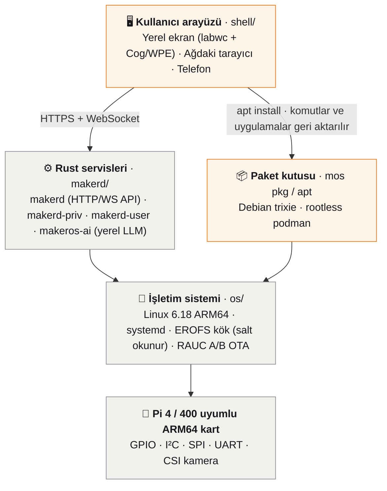
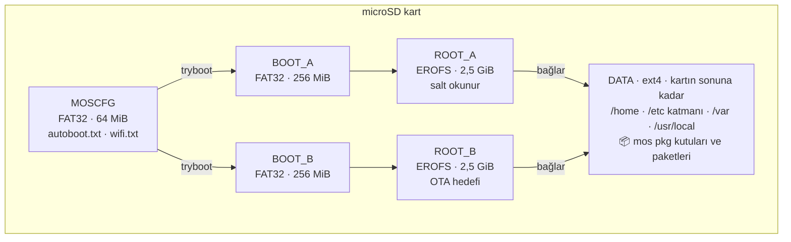
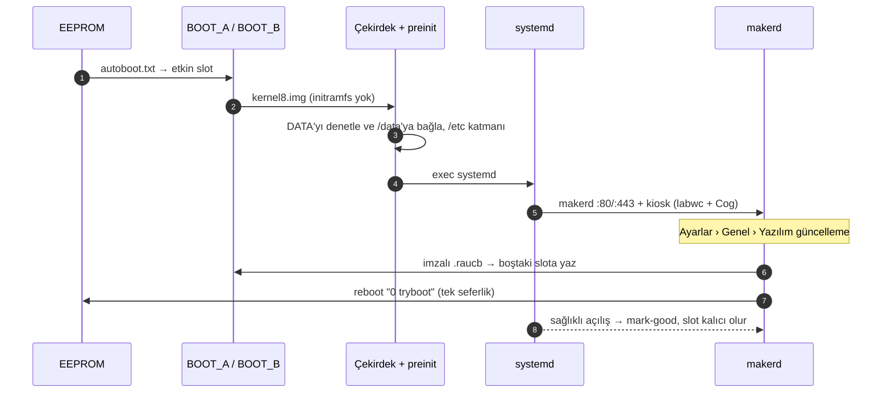
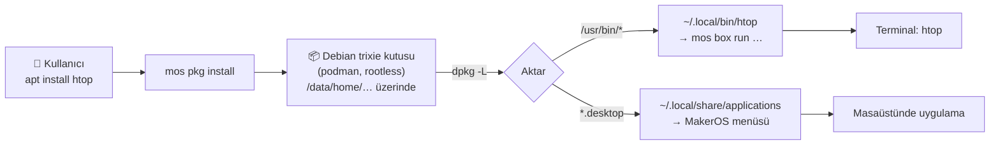

<p align="center">
  <a href="https://github.com/ferhatozcelik/maker-os">
    
  </a>
</p>

<h1 align="center">MakerOS</h1>

<p align="center">ARM64 tabanlı, Pi 4 uyumlu kartlarda çalışan bağımsız ve tamamen açık kaynaklı Linux işletim sistemi.</p>

<p align="center"><strong>Make it yours. Build what matters.</strong> · <em>Kendine ait kıl. Değerli olanı üret.</em></p>

<p align="center">
  <a href="https://github.com/ferhatozcelik/maker-os/releases/tag/v1.0.0"></a>
  
  
  <a href="LICENSE"></a>
</p>

<p align="center">
  <a href="https://github.com/ferhatozcelik/maker-os/releases/latest">İndir</a> ·
  <a href="#features">Özellikler</a> ·
  <a href="#architecture">Mimari</a> ·
  <a href="#packages">Paketler</a> ·
  <a href="#setup-guide">Kurulum rehberi</a> ·
  <a href="#documentation">Dokümantasyon</a> ·
  <a href="docs/api.md">API</a> ·
  <a href="CONTRIBUTING.md">Katkıda bulun</a>
</p>

<p align="center">
  <a href="README.md">Türkçe</a> ·
  <a href="README.en.md">English</a>
</p>

<p align="center">
  <strong>Projeyi destekleyin</strong><br>
  <a href="https://buymeacoffee.com/ferhatozcelik">Buy Me a Coffee</a> ·
  <a href="https://thanks.dev/donations">thanks.dev</a>
</p>

<br>

<table align="center">
  <tr>
    <th align="center" colspan="2">Masaüstü · Tarayıcı ve Yerel AI Asistanı</th>
  </tr>
  <tr>
    <td align="center" colspan="2"></td>
  </tr>
  <tr>
    <th align="center">Web arayüzü</th>
    <th align="center">Telefon</th>
  </tr>
  <tr>
    <td align="center" valign="top"></td>
    <td align="center" valign="top"></td>
  </tr>
  <tr>
    <th align="center" colspan="2">Ayarlar · Genel ve Yazılım Güncelleme</th>
  </tr>
  <tr>
    <td align="center" colspan="2"></td>
  </tr>
</table>

## Nedir?

MakerOS, Pi 4 uyumlu ARM64 kartlar gibi erişilebilir donanımlar üzerinde çalışan, kullanıcıya kendi bilgisayarını ve dijital üretim ortamını yönetme özgürlüğü sunan bağımsız bir Linux işletim sistemidir. Hazır bir dağıtımın üzerine masaüstü giydirmek yerine; kendi önyükleme zincirini, Rust tabanlı sistem servislerini (`makerd`), web masaüstü kabuğunu, A/B güncelleme altyapısını ve yerel yapay zekâ asistanını tek bir bütün olarak sunar.

Sadeliği ve kullanım kolaylığını Linux'un esnekliğiyle birleştiren özgün bir üretim atölyesi olmayı hedefler.

**Bilgisayar yeniden kişisel olmalı.** Geleneksel sistemlerde kullanıcılar çoğu zaman kapalı ekosistemlerin ve kara kutu servislerin sınırları içinde hareket eder. MakerOS, *"Bir bilgisayarı gerçekten kendimiz için tasarlayabilir miyiz?"* sorusuyla küçük bir ARM kart üzerinde doğdu. Amacımız pahalı donanımlara ihtiyaç duymadan, kullanıcının sistemini anlayabildiği, değiştirebildiği ve kendi fikirlerini hayata geçirebildiği şeffaf bir ortam kurmaktır.

MakerOS beş temel ilkeye dayanır: **Özgürlük** (kontrol kullanıcıdadır), **Basitlik** (güçlü teknoloji karmaşık olmamalıdır), **Üretkenlik** (tüketim değil üretim odaklıdır), **Şeffaflık** (sistem nasıl çalıştığını açıkça gösterir) ve **Erişilebilirlik** (uygun maliyetli ARM64 donanımlarda çalışır). Yapay zekâ ise bilgisayarın kontrolünü kullanıcıdan alan bir mekanizma değil, kullanıcının yeteneklerini genişleten yerel bir yardımcıdır.

> **Manifesto:** Bilgisayarların yalnızca tüketmek için var olduğuna ve güçlü deneyimlerin kapalı ekosistemlere ait olması gerektiğine inanmıyoruz. Sadelik ile özgürlüğün, açık kaynak ile iyi tasarımın bir arada bulunabileceğini savunuyoruz. Teknoloji kullanıcıya ne yapacağını söylememeli; kullanıcının ne yapabileceğini genişletmelidir.
>
> **Make it yours. Build what matters.** — *Kendine ait kıl. Değerli olanı üret.*

## İndir

[Sürüm 1.0.0](https://github.com/ferhatozcelik/maker-os/releases/latest): `makeros-1.0.0-rpi4.img.xz` (Pi 4 / 400 uyumlu kartlar, ARM64). İndirdikten sonra `sha256sum -c makeros-*.img.xz.sha256` ile doğrulayın.

<a id="features"></a>

## Özellikler

| Alan | İçerik |
| --- | --- |
| **Taban** | Buildroot + Linux 6.18 (ARM64) üzerine kurulu bağımsız sistem; salt okunur EROFS kök dosya sistemi, ext4 `/data` bölmesi, RAUC + `tryboot` A/B güncelleme, systemd |
| **Masaüstü ve Web** | Yerel ekranda Cog/WPE WebKit ve ağ üzerinden tarayıcıda aynı deneyim: pencereli **Ekran** (`/`) ve mobil uyumlu **Web** (`/web`) görünümü |
| **Rust Arka Uç** | `makerd` (HTTP/WS API), `makerd-priv` (ayrıcalıklı işlemler), `makerd-user` (kullanıcı süreçleri ve PTY terminal), `makeros-ai` (yerel AI servisi) |
| **Yerel AI Asistanı** | Qwen2.5-0.5B-Instruct GGUF + `llama.cpp` tabanlı Türkçe asistan; sohbet modu, MakerOS bilgi bankası, bağlam temizleme, risk sınıflandırması ve Full Bypass / İzinli komut çalıştırma |
| **Paket Yöneticisi** | Debian'daki gibi `apt install` / `mos pkg`: paketler microSD'deki kullanıcı kutusuna (Debian trixie, rootless podman) kurulur; komutlar ve uygulamalar MakerOS'a otomatik aktarılır ([ayrıntı](docs/architecture/packages.md)) |
| **Python ve Otomasyon** | `uv` tabanlı sanal ortam ve proje yöneticisi, hazır GPIO/Kamera/Web/AI şablonları; **Otomatik Başlatma** ve **Cron** zamanlayıcı ile açılışta veya zamanlanmış görevlerle çalıştırma |
| **Donanım ve Kamera** | 40-pin GPIO canlı kontrolü, I²C, SPI, UART; CSI ve USB kameralar için canlı MJPEG akışı ve fotoğraf çekimi |
| **Eklentiler ve Temalar** | Python eklenti mimarisi, Eklenti Mağazası (`makeros-plugins`), `.zip` içe/dışa aktarma; Maker (varsayılan), Donanım, Siber, 3B Baskı ve Konya HackerSpace temaları, düz (flat) düşük GPU modu ve Sistem UI gizleme |

<a id="architecture"></a>

## Mimari

MakerOS katmanlardan oluşur; her katman kendi dizininde durur ve kendi belgesiyle anlatılır.



**Katman belgeleri:** [Masaüstü kabuğu](docs/architecture/desktop.md) · [Rust arka uç](docs/architecture/backend.md) · [Yerel AI](docs/architecture/ai-assistant.md) · [Paket yöneticisi](docs/architecture/packages.md) · [Önyükleme ve depolama](docs/architecture/boot-and-storage.md) · [Ağ ve güvenlik](docs/architecture/network-security.md) · [Donanım](docs/architecture/hardware.md)

### microSD bölüm düzeni

Sistem salt okunur iki kök bölümle (A/B) çalışır; tüm kullanıcı verisi ve kurulan paketler `DATA` bölümündedir. Bu yüzden güncellemeler verinize dokunmaz. Ayrıntı: [Önyükleme ve Depolama](docs/architecture/boot-and-storage.md).



### Açılış ve güncelleme akışı



<a id="packages"></a>

## Paket Yöneticisi (`mos pkg` / `apt`)

Kök dosya sistemi salt okunur olduğu hâlde Debian'daki gibi paket kurabilirsiniz. `mos pkg` (ya da alışkın olduğunuz `apt` / `apt-get`) paketleri microSD'deki `DATA` bölümünde duran, kullanıcı yetkisiyle çalışan bir Debian trixie kutusuna kurar. Paketin komutları ve masaüstü uygulamaları otomatik olarak MakerOS'a aktarılır: terminalde doğrudan çalışır, uygulamalar menüde görünür. Ayrıntı: [Paket Yöneticisi](docs/architecture/packages.md).



```bash
apt install htop           # ya da: mos pkg install htop
htop                       # MakerOS terminalinde doğrudan çalışır
mos pkg list               # mos pkg ile kurulan paketler
apt upgrade                # kutudaki paketleri güncelle, aktarımları yenile
apt remove htop            # paketi ve aktarılan komutları kaldır
mos box                    # tam Debian kabuğuna gir (sudo apt, gcc, make …)
```

<a id="documentation"></a>

## Dokümantasyon

Tüm belgeler Türkçe ve İngilizcedir; giriş sayfası: [`docs/`](docs/README.md).

| Konu | Türkçe | English |
| --- | --- | --- |
| Genel bakış | [overview.md](docs/architecture/overview.md) | [overview.en.md](docs/architecture/overview.en.md) |
| Önyükleme ve depolama | [boot-and-storage.md](docs/architecture/boot-and-storage.md) | [boot-and-storage.en.md](docs/architecture/boot-and-storage.en.md) |
| Masaüstü kabuğu | [desktop.md](docs/architecture/desktop.md) | [desktop.en.md](docs/architecture/desktop.en.md) |
| Rust arka uç | [backend.md](docs/architecture/backend.md) | [backend.en.md](docs/architecture/backend.en.md) |
| Paket yöneticisi | [packages.md](docs/architecture/packages.md) | [packages.en.md](docs/architecture/packages.en.md) |
| Yerel AI asistanı | [ai-assistant.md](docs/architecture/ai-assistant.md) | [ai-assistant.en.md](docs/architecture/ai-assistant.en.md) |
| Ağ ve güvenlik | [network-security.md](docs/architecture/network-security.md) | [network-security.en.md](docs/architecture/network-security.en.md) |
| Donanım | [hardware.md](docs/architecture/hardware.md) | [hardware.en.md](docs/architecture/hardware.en.md) |
| Derleme ve test | [build-and-test.md](docs/development/build-and-test.md) | [build-and-test.en.md](docs/development/build-and-test.en.md) |
| Doğrulama durumu | [validation.md](docs/verification/validation.md) | [validation.en.md](docs/verification/validation.en.md) |
| Marka ve lisans | [branding-and-licensing.md](docs/project/branding-and-licensing.md) | [branding-and-licensing.en.md](docs/project/branding-and-licensing.en.md) |
| HTTP/WS API | [api.md](docs/api.md) | [api.en.md](docs/api.en.md) |

Kaynak dizinleri: [`os/`](os/README.md) (Buildroot dış ağacı, çekirdek, paketler, imaj) · [`makerd/`](makerd/) (Rust sistem servisleri ve AI) · [`shell/`](shell/README.md) (web masaüstü ve uygulamalar) · [`site/`](site/index.html) ([tanıtım sayfası](https://ferhatozcelik.github.io/maker-os/)).

<a id="setup-guide"></a>

## Kurulum Rehberi

1. **SD Karta Yazın:** [Sürüm sayfasından](https://github.com/ferhatozcelik/maker-os/releases/latest) `makeros-1.0.0-rpi4.img.xz` dosyasını indirin ve herhangi bir imaj yazma aracıyla (ör. balenaEtcher ya da `dd`) SD karta yazın. İsteğe bağlı olarak `MOSCFG` bölümündeki `wifi-example.txt` dosyasını `wifi.txt` adıyla kopyalayıp Wi-Fi bilgilerinizi girebilirsiniz.
2. **Başlatın ve Bağlanın:** SD kartı Pi 4 / 400 uyumlu kartınıza takıp gücü verin. Aynı ağdaysanız `http://maker-os.local/`, USB-C ile bağlıysanız `http://10.55.0.1/`, ağ tanımlı değilse `MakerOS` kurulum Wi-Fi ağına bağlanarak `http://10.42.0.1/kurulum` adresini açın.
3. **Oturum Açın:** İlk kurulumdan sonra varsayılan hesap **`makeros` / `makeros`** olarak oluşturulur; parolanızı **Ayarlar › Kullanıcı** bölümünden değiştirebilirsiniz.
4. **OTA Güncelleme:** **Ayarlar › Genel › Yazılım güncelleme** üzerinden yeni sürümler denetlenir, imzalı `.raucb` paketi boştaki bölüme (`ROOT_A` / `ROOT_B`) kurulur ve `tryboot` ile güvenle devreye alınır.

<a id="build-from-source"></a>

## Kaynaktan Derleme ve Hızlı Komutlar

```bash
make -C makerd preview     # yerel önizleme: makerd (mock) + kabuk → http://localhost:8080/
make -C shell smoke        # kabuk duman testi (Docker içinde başsız Chromium)
./os/build.sh build        # ARM64 (Pi 4 uyumlu) imaj → os/out/makeros-1.0.0-rpi4.img.xz
```

Ayrıntılı derleme ve geliştirme adımları için bkz. [`docs/development/build-and-test.md`](docs/development/build-and-test.md).

## Doğrulama Durumu

Masaüstü kabuğu (`shell/`), `makerd` servis ailesi, yerel AI asistanı (`makeros-ai`), terminal oturumları, Python Yöneticisi, Otomatik Başlatma / Cron zamanlayıcı ve OTA güncelleme akışı hem Docker duman testleriyle hem de gerçek Pi 4 uyumlu ARM64 donanım üzerinde doğrulanmıştır. Nelerin gerçek donanımda doğrulandığı ve gelecek planlarının ayrımı için bkz. [`docs/verification/validation.md`](docs/verification/validation.md).

## Lisans

[MIT](LICENSE) — Üçüncü taraf bileşenlerin lisans bildirimleri için [`NOTICE.md`](NOTICE.md) ve [`docs/project/branding-and-licensing.md`](docs/project/branding-and-licensing.md) belgelerine bakın.

**MakerOS bağımsız bir açık kaynak projesidir.** Herhangi bir donanım ya da yazılım üreticisiyle ortaklık, sponsorluk veya resmî bağ iddia etmez. Anılan ürün adları sahiplerinin markalarıdır ve yalnız uyumluluğu belirtmek için kullanılır.
