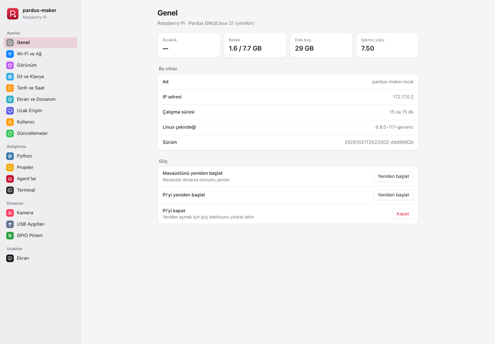
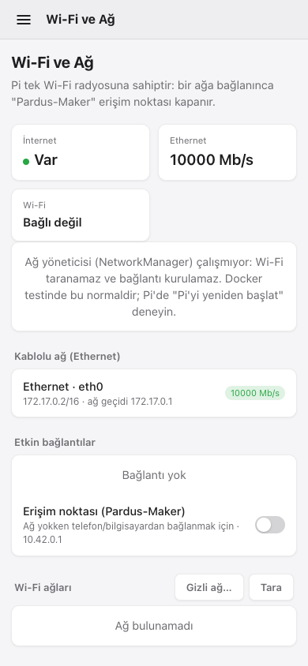
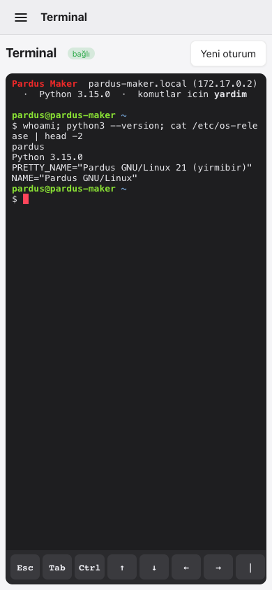
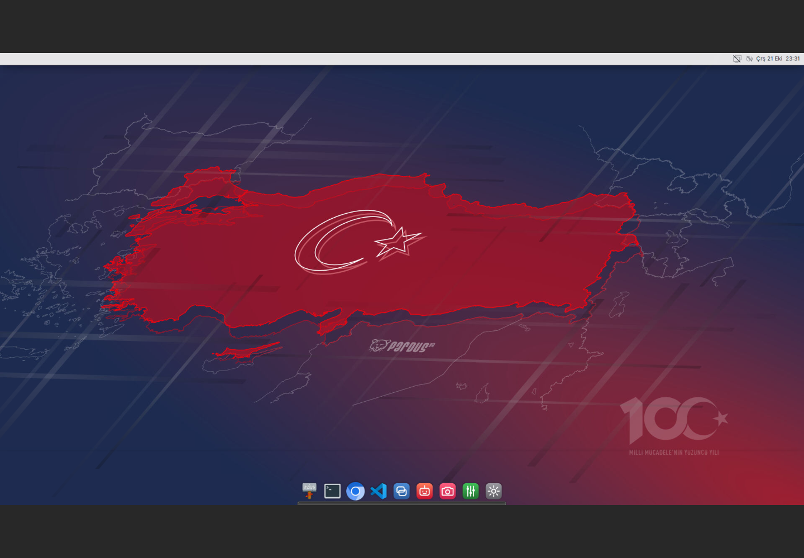
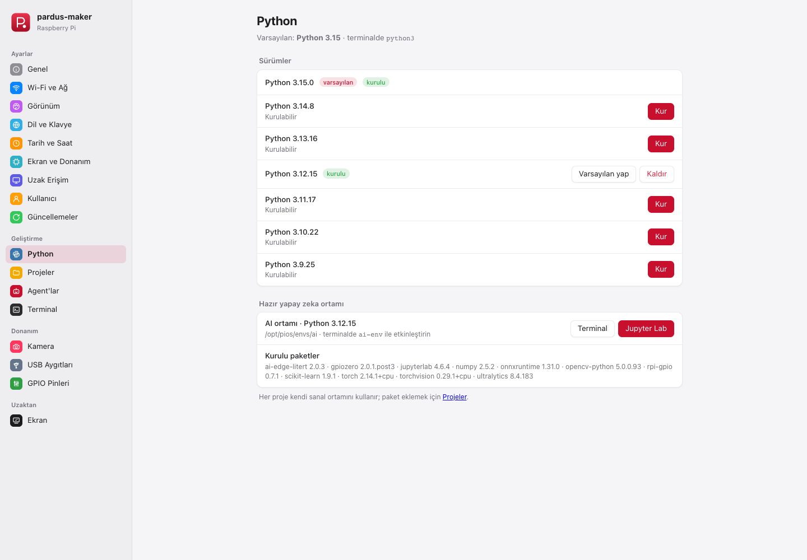
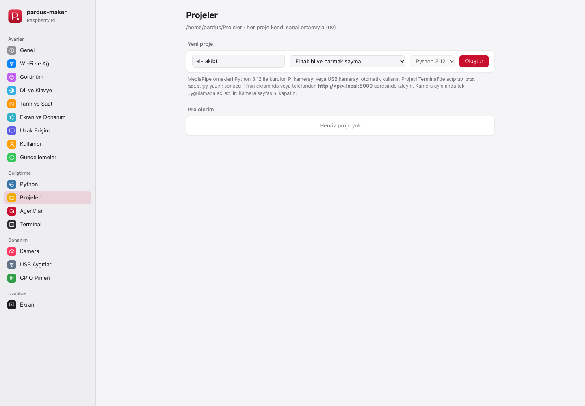

<p align="center">
  <a href="https://github.com/ferhatozcelik/pardus-maker">
    
  </a>
</p>

<h1 align="center">Pardus Maker</h1>

<p align="center">Raspberry Pi için kurulumsuz, hazır kurulu Pardus: öğrenciler, yapıcılar ve yapay zeka projeleri.</p>

<p align="center"><strong>SD karta yaz. Pi'yi aç. Tarayıcıdan bağlan.</strong></p>

<p align="center">
  <a href="https://github.com/ferhatozcelik/pardus-maker/releases/tag/v1.1.0"></a>
  
  
  <a href="LICENSE"></a>
</p>

<p align="center">
  <a href="https://github.com/ferhatozcelik/pardus-maker/releases/tag/v1.1.0">İndir</a> ·
  <a href="#kurulum-rehberi">Kurulum rehberi</a> ·
  <a href="#özellikler">Özellikler</a> ·
  <a href="#kaynaktan-derleme">Kaynaktan derleme</a> ·
  <a href="docs/README.md">Belgeler</a> ·
  <a href="CONTRIBUTING.md">Katkı</a>
</p>

<p align="center">
  <a href="README.md">Türkçe</a> ·
  <a href="README.en.md">English</a>
</p>

<br>

<table align="center">
  <tr>
    <th align="center">Pardus Maker Merkezi</th>
    <th align="center">Telefon · Wi-Fi</th>
    <th align="center">Telefon · Terminal</th>
  </tr>
  <tr>
    <td align="center" valign="top"></td>
    <td align="center" valign="top"></td>
    <td align="center" valign="top"></td>
  </tr>
  <tr><th align="center" colspan="3">Uzak masaüstü (tarayıcıda)</th></tr>
  <tr><td align="center" colspan="3"></td></tr>
</table>

<table align="center">
  <tr><th>Python ve yapay zeka ortamı</th><th>MediaPipe proje şablonları</th></tr>
  <tr>
    <td></td>
    <td></td>
  </tr>
</table>

Görüntüler güncel build'in Docker ortamında, masaüstü ve telefon boyutlarında çekilmiştir.
Kamera, Wi-Fi ve GPIO'nun donanım testleri Raspberry Pi gerektirir.
Tüm görüntüler için [ekran görüntüsü galerisine](docs/ekran-goruntuleri.md) bakın.

## İndir

[Sürüm 1.1.0](https://github.com/ferhatozcelik/pardus-maker/releases/tag/v1.1.0): `pardus-maker-<sürüm>.img.xz` (Raspberry Pi 4 / 400 / 3B+, 64 bit).
İndirdikten sonra `sha256sum -c pardus-maker-*.img.xz.sha256` ile doğrulayın.

## Özellikler

| Alan | İçerik |
| --- | --- |
| Taban | Pardus 21 "Yirmibir" (Debian 11) arm64 + Pardus güvenlik deposu, Raspberry Pi'nin güncel çekirdeği (`-v8+`) |
| Masaüstü | XFCE, macOS benzeri: üst çubuk + Plank dock, Pardus **100. Yıl** teması (açık/koyu), Chromium, VS Code, Dosyalar, Terminal |
| Pardus Maker Merkezi | Tek web uygulaması (port 80), telefona uyumlu: ayarlar, ağ, tarih-saat, dil-klavye, Python, projeler, agent'lar, terminal, kamera, USB, GPIO, uzak ekran |
| Ağ | Ethernet (durum, hız), Wi-Fi tarama, gizli ağ, okul/kurum ağı (WPA2-Enterprise, eduroam), kayıtlı ağlar; ağ yoksa `Pardus-Maker-XXXX` erişim noktası |
| Web terminali | Tarayıcıda gerçek kabuk (xterm.js), telefon için Esc/Tab/Ctrl/ok tuşları; root değil, `pardus` kullanıcısı |
| Kamera | Pi kamera modülleri (libcamera, picamera2) ve USB kameralar: canlı görüntü, tam çözünürlükte fotoğraf, galeri |
| MediaPipe | Kamerayla çalışan 7 hazır proje: el takibi, jest ile LED (GPIO), yüz, poz/egzersiz sayacı, nesne algılama, arka plan ayırma, yüz ağı. Modeller imajda, internet gerekmez |
| Python ve yapay zeka | uv ile her Python sürümü tek tıkla; hazır AI ortamı (`ai-env`): PyTorch, ONNX Runtime, LiteRT, OpenCV, Ultralytics, Jupyter Lab |
| Donanım | GPIO (sudo'suz), I2C, SPI, UART; USB bellek bağla/güvenle çıkar, Arduino/ESP32 seri portları; HDMI 0/1, DSI dokunmatik ekran, HDMI/3.5 mm ses |
| İzleme ve soğutma | Türkçe Görev Yöneticisi: CPU, RAM, işlemler, anlık ağ aktarımı ve toplam sayaçlar; GPIO kontrollü fan için sıcaklık eşikleri |
| Python eklentileri | Genel Python proje şablonu, ZIP içe aktarma, uygulama listesi, başlat/durdur ve çalışma günlüğü; [eklenti rehberi](docs/eklentiler.md) |
| Agent'lar | Claude Code, Codex CLI, Gemini CLI, OpenCode, Antigravity, Ollama: Merkez'den kur, güncelle, başlat |
| Uzak erişim | Web (masaüstü + tüm ayarlar), VNC (5900), SSH, mDNS (`pardus-maker.local`) |

Bilinçli olarak **yok**: ofis paketi, e-posta, görüntüleyiciler gibi genel
masaüstü uygulamaları. Hedef: öğrenci, DIY ve yapay zeka projeleri için hızlı
ve sade bir sistem.

## Kurulum rehberi

### 1. SD karta yazın

macOS'ta proje klasöründen `./flash-sd.sh` çalıştırabilirsiniz. Betik
`image/out/` içindeki imajı seçer, harici veya çıkarılabilir fiziksel diskleri listeler ve
seçtiğiniz diski açık onayınızdan sonra silip imajı yazar. Yazılan veriyi
karttan geri okuyarak SHA-256 ile doğrular ve kartı çıkarır. Farklı bir
imaj için `./flash-sd.sh /yol/imaj.img.xz` kullanın (`.xz` için `xz`
gereklidir). Yazma sırasında macOS kullanıcı parolanız istenir.

Grafik arayüzle yazmak için:

1. [Sürüm sayfasından](https://github.com/ferhatozcelik/pardus-maker/releases/tag/v1.1.0) `.img.xz` dosyasını indirin. 16 GB veya daha büyük bir kart önerilir.
2. [Raspberry Pi Imager](https://www.raspberrypi.com/software/)'da **İşletim sistemi → Özel imaj kullan** (Use custom) ile dosyayı seçin. Imager'ın "işletim sistemi özelleştirme" ayarlarını **kullanmayın**. balenaEtcher da olur.
3. Yazma ve doğrulama bitene kadar bekleyin.

### 2. (İsteğe bağlı) Evdeki Wi-Fi'ye doğrudan bağlansın

Kartı bilgisayara takın, `bootfs` bölümündeki `wifi-ornek.txt` dosyasını
`wifi.txt` olarak kopyalayın, `SSID` ve `PAROLA` satırlarını doldurun.
Pi açılınca ağı ekler ve parola içeren dosyayı siler.

### 3. Pi'yi açın ve bağlanın

İlk açılışta kök bölüm kartın tamamına genişler ve cihaza özel SSH anahtarları
üretilir (yaklaşık 1 dakika). Monitör, klavye veya kurulum sihirbazı gerekmez.

| Durum | Adres |
| --- | --- |
| Ethernet kablosu takılı veya `wifi.txt` var | `http://pardus-maker.local/` |
| Ağ yok | ~45 sn sonra `Pardus-Maker-XXXX` Wi-Fi ağı açılır (parola `pardus1234`) → `http://10.42.0.1/` |
| Monitör takılı | Masaüstü doğrudan açılır; Merkez dock'taki simgelerden |

Giriş ekranında kullanıcı `pardus`, parola `pardus`. Ağdan ilk girişte masaüstü açılır;
telefonda ekranı yatay çevirin. Üstteki **‹ Merkez** ile ayarlara geçilir.

IP bulunamazsa kartı bilgisayara takıp `bootfs` bölümündeki
`pardus-durum.txt` dosyasına bakın.

### 4. İlk iş: parolayı değiştirin

Varsayılan parola tüm imajlarda aynıdır. **Merkez → Kullanıcı** bölümünden
değiştirin; giriş, SSH, sudo, web ve uzak ekran parolası birlikte değişir.
Web ve VNC trafiği şifrelenmez, yalnızca güvendiğiniz yerel ağda kullanın.

### 5. Kamera ve MediaPipe

1. Pi kapalıyken kamera kablosunu **CAMERA** yuvasına takın. **Merkez → Kamera**'da canlı görüntü gelmeli.
2. **Merkez → Projeler → Yeni proje** bölümünde şablon olarak bir **MediaPipe** örneği seçin, örneğin "El takibi ve parmak sayma".
3. Projeyi **Terminal** ile açıp çalıştırın:

```bash
uv run main.py                     # Pi kamera veya USB kamera, otomatik
uv run main.py --kaynak video.mp4  # kamera yoksa video dosyası
```

Sonuç Pi'nin ekranında bir pencerede ve telefondan
`http://pardus-maker.local:8000/` adresinde canlı görünür. Kamera aynı anda
tek uygulamada açılabilir; örnek çalışırken Merkez'deki Kamera sayfasını kapatın.

| Örnek | Ne yapar | Donanım |
| --- | --- | --- |
| El takibi | 21 eklem noktası, açık parmak sayısı | Kamera |
| Jest ile LED | 👍 LED yakar, 👎 söndürür, ✋ buzzer | Kamera, LED (GPIO17), buzzer (GPIO27) |
| Yüz algılama | Yüzleri çerçeveler, yeni yüzde otomatik fotoğraf | Kamera |
| Poz | Squat ve kol kaldırma sayacı | Kamera |
| Nesne algılama | 80 sınıf (kişi, araba, kedi...), kişi görünce alarm | Kamera, isteğe bağlı GPIO17 |
| Arka plan ayırma | Bulanık, tek renk veya resimli arka plan | Kamera |
| Yüz ağı | 478 nokta, göz kırpma sayacı, gülümseme | Kamera |

### Donanım uyumluluğu

| Model | Durum |
| --- | --- |
| Raspberry Pi 4 Model B (2/4/8 GB) | Hedef platform |
| Raspberry Pi 400 | Destekleniyor |
| Raspberry Pi 3B+ | Çalışır; yapay zeka ve MediaPipe yavaştır |
| Raspberry Pi 5 | Henüz desteklenmiyor (farklı çekirdek ve kamera yığını) |

## Kaynaktan derleme

Çalışan Pi'deki Merkez'i SD kartı silmeden güncellemek için:

```bash
./update-center.sh pardus@pardus-maker.local   # cihazın IP adresi de kullanılabilir
```

Betik eski dosyaları yedekler ve Merkez servisini yeniden başlatır.
Tarayıcıyı yenileyin. Bu işlem mevcut `.img` dosyasını değiştirmez;
fan yapılandırması ayrıca Pi'nin yeniden başlatılmasını gerektirir.

Apple Silicon Mac'te (arm64, qemu gerekmez) veya arm64 Linux'ta Docker ile:

```bash
colima start --arch aarch64 --cpu 6 --memory 8 --disk 60   # yalnızca macOS
cd image
./build-docker.sh          # tüm aşamalar → image/out/pardus-maker-<sürüm>.img.xz
./build-docker.sh 06       # yapılandırmadan devam et (06–09)
./test/run-test.sh         # imajın kök dosya sistemini Docker'da çalıştır
```

Docker testi: `http://localhost:8080/` (`pardus` / `pardus`). Konteynerde HDMI
yerine Xvfb kullanılır (varsayılan `1280x720`; `PIOS_RESOLUTION` ile değiştirilir).
Wi-Fi, kamera, GPIO ve güç işlemleri çalışmaz; uzak ekran gerçek Pi + LAN’a
göre daha yavaş olabilir.

| Aşama | İş |
| --- | --- |
| `01-pin-base` | Pardus deposu ve raspberrypi/firmware commit'ini sabitler |
| `02-build-rootfs` | debootstrap minbase (arm64) |
| `03-add-hw-packages` | Çekirdek, modüller, DTB/overlay, Wi-Fi/BT donanım yazılımı, `config.txt` |
| `04-install-desktop` | XFCE, Chromium, Pardus temaları, kamera yığını (libcamera), ffmpeg, udisks2, `pardus` kullanıcısı |
| `05-install-dev-tools` | uv, en güncel Python, AI ortamı, Node.js LTS, VS Code |
| `06-configure-system` | overlay, xterm.js ve MediaPipe modelleri (sabit sürüm + sha256), Merkez, VNC, servisler |
| `07-cleanup` | apt önbelleği, SSH anahtarları, machine-id temizliği |
| `08-package-image` | Döngü aygıtı kullanmadan imaj: `mkfs.ext4 -d` + mtools + sfdisk |
| `09-checksums-and-manifest` | `.img.xz`, sha256, paket/sürüm manifesti |

## Klasörler

| Parça | Klasör |
| --- | --- |
| Build hattı | [`image/stages/`](image/stages/), [`image/lib/`](image/lib/) |
| Kök dosya sistemine kopyalanan dosyalar | [`image/overlay/`](image/overlay/) |
| Pardus Maker Merkezi (Python 3.9 stdlib + web arayüzü) | [`image/overlay/usr/lib/pios/center/`](image/overlay/usr/lib/pios/center/) |
| MediaPipe örnek projeleri | [`image/overlay/usr/lib/pios/templates/`](image/overlay/usr/lib/pios/templates/) |
| Docker test konteyneri | [`image/test/`](image/test/) |
| Belgeler: mimari, Merkez API'si, donanım, MediaPipe, sorun giderme, kararlar | [`docs/`](docs/README.md) |

Sistem içi servis ve yol adları (`pios-*`, `/usr/lib/pios`) teknik kimliktir
ve sürümler arasında sabit tutulur.

## Lisans ve marka açıklaması

Pardus Maker için bu depoda geliştirilen özgün kaynak kodu, build betikleri,
yapılandırmalar ve örnekler **GNU Genel Kamu Lisansı sürüm 3 veya sonraki
herhangi bir sürüm** (`GPL-3.0-or-later`) kapsamında sunulur. Kullanma,
inceleme, değiştirme ve yeniden dağıtma hakları ile bunların koşulları
[`LICENSE`](LICENSE) dosyasındaki lisans metninde yer alır.

Bu lisans, imajdaki bütün yazılımların aynı lisansa sahip olduğu anlamına
gelmez. Pardus/Debian paketleri, Linux çekirdeği, firmware, temalar, modeller
ve diğer üçüncü taraf bileşenler kendi hak sahiplerine ve lisanslarına
tabidir. Bileşen listesi ve kaynak bağlantıları [`NOTICE.md`](NOTICE.md)
dosyasındadır. Yeniden dağıtımda ilgili lisans ve telif bildirimleri
korunmalı; kaynak kodu sağlama yükümlülükleri bileşen ve dağıtım biçimine
göre yerine getirilmelidir. Yalnızca bu depoya veya üst projenin ana
sayfasına bağlantı vermek her durumda yeterli değildir.

**Pardus Maker bağımsız bir topluluk projesidir.** TÜBİTAK'ın veya Pardus
projesinin resmî bir sürümü, ürünü ya da hizmeti değildir; bu kuruluşlar
adına geliştirilmez. Bir ortaklık, sponsorluk, sertifikasyon, onay veya
resmî destek ilişkisi iddia edilmez. Projeye özgü hata ve destek talepleri
bu deponun [Issues](https://github.com/ferhatozcelik/pardus-maker/issues)
bölümüne iletilmelidir.

Pardus adı ve görsel kimliğine ilişkin haklar ilgili hak sahiplerine aittir.
**Raspberry Pi is a trademark of Raspberry Pi Ltd.** Bu belgelerdeki marka
atıfları kullanılan tabanı ve hedef donanımı tanımlamak içindir. Yazılım
lisansı marka veya logo kullanım izni vermez; bu açıklama da böyle bir izin
yerine geçmez. Proje adı, logolar ve temalardaki marka kullanımları ilgili
hak sahiplerinin koşullarına ayrıca tabidir; bkz.
[Raspberry Pi marka kuralları](https://www.raspberrypi.com/trademark-rules/).

Yazılım, yürürlükteki hukukun izin verdiği ölçüde, lisanslarda belirtilen
şekilde **olduğu gibi ve garanti verilmeksizin** sunulur. Bu açıklama,
emredici hukuk kurallarından doğan hakları sınırlamaz ve hukuki uygunluk
belgesi değildir. Ayrıntılar: [lisans ve dağıtım notları](docs/lisans.md).
