<p align="center">
  <a href="https://github.com/ferhatozcelik/maker-os">
    
  </a>
</p>

<h1 align="center">MakerOS</h1>

<p align="center">ARM64 tabanlı, Pi 4 uyumlu kartlarda çalışan bağımsız ve tamamen açık kaynaklı Linux işletim sistemi.</p>

<p align="center"><strong>Atölyen cebinde.</strong> · <em>Your workshop, in your pocket.</em></p>

<p align="center">
  <a href="https://github.com/ferhatozcelik/maker-os/releases/tag/v1.0.0"></a>
  
  
  <a href="LICENSE"></a>
</p>

<p align="center">
  <a href="https://ferhatozcelik.github.io/maker-os/">Web sitesi</a> ·
  <a href="https://github.com/ferhatozcelik/maker-os/releases/latest">İndir</a> ·
  <a href="#features">Özellikler</a> ·
  <a href="#architecture">Nasıl çalışır?</a> ·
  <a href="#packages">Paketler</a> ·
  <a href="#plugins">Eklentiler</a> ·
  <a href="#performance">Başarım</a> ·
  <a href="#setup-guide">Kurulum</a> ·
  <a href="#documentation">Dokümantasyon</a> ·
  <a href="docs/api.md">API</a> ·
  <a href="CONTRIBUTING.md">Katkıda bulun</a>
</p>

<p align="center">
  <a href="README.md">Türkçe</a> ·
  <a href="README.en.md">English</a>
</p>

<br>

<table align="center">
  <tr>
    <th align="center" colspan="2">Masaüstü · Tarayıcı ve Yerel AI Asistanı</th>
  </tr>
  <tr>
    <td align="center" colspan="2">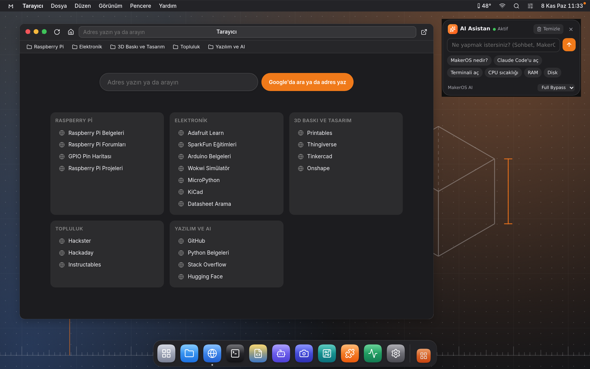</td>
  </tr>
  <tr>
    <th align="center">Web arayüzü</th>
    <th align="center">Telefon</th>
  </tr>
  <tr>
    <td align="center" valign="top">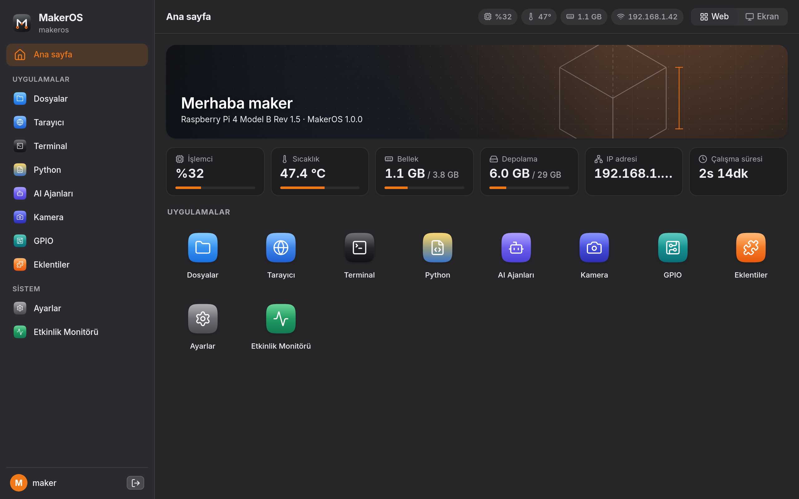</td>
    <td align="center" valign="top">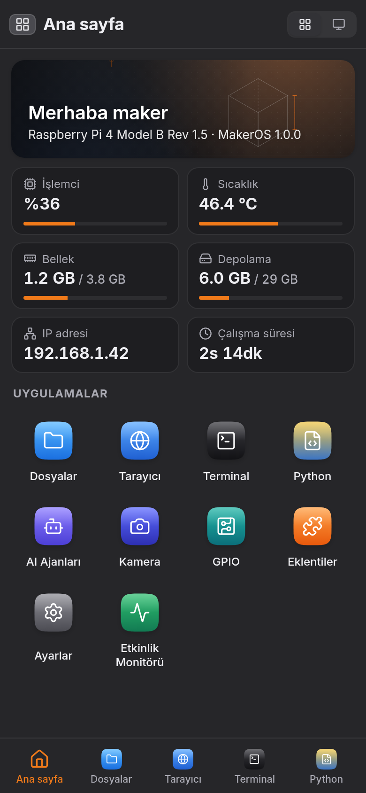</td>
  </tr>
  <tr>
    <th align="center" colspan="2">Ayarlar · Genel ve Yazılım Güncelleme</th>
  </tr>
  <tr>
    <td align="center" colspan="2">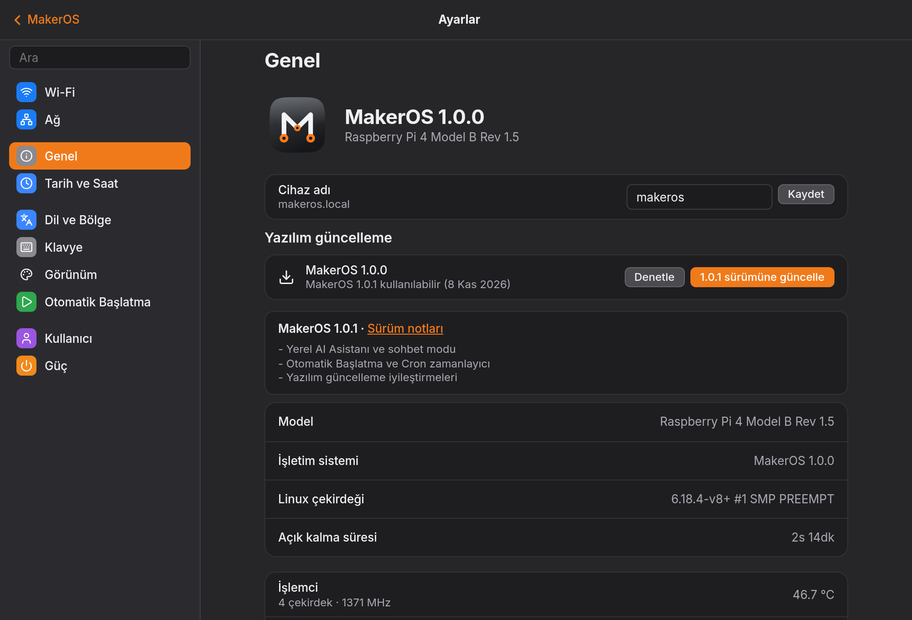</td>
  </tr>
</table>

## Nedir?

MakerOS, Pi 4 / 400 uyumlu ARM64 kartlar için hazırlanmış bağımsız ve açık kaynaklı bir Linux işletim sistemidir. Kartı bir ekrana bağlayarak masaüstü bilgisayar gibi, ya da ağdaki herhangi bir tarayıcıdan veya telefondan uzaktan kullanabilirsiniz. Terminal, dosyalar, Python projeleri, GPIO, kamera ve internetsiz çalışan bir yapay zekâ asistanı hazır gelir.

**Bilgisayar yeniden kişisel olmalı.** MakerOS, *"Bir bilgisayarı gerçekten kendimiz için tasarlayabilir miyiz?"* sorusuyla küçük bir ARM kart üzerinde doğdu. Amaç; pahalı donanım gerektirmeyen, nasıl çalıştığını anlayabildiğiniz, değiştirebildiğiniz ve fikirlerinizi hayata geçirebildiğiniz bir sistem.

> Teknoloji kullanıcıya ne yapacağını söylememeli; kullanıcının ne yapabileceğini genişletmeli.
>
> **Atölyen cebinde.** — *Your workshop, in your pocket.*

## İndir

[Sürüm 1.0.0](https://github.com/ferhatozcelik/maker-os/releases/latest): `makeros-1.0.0-rpi4.img.xz` (Pi 4 / 400 uyumlu kartlar, ARM64) ve imzalı güncelleme paketi `makeros-1.0.0-rpi4.raucb`. En kolay yol: [Kurulum](#setup-guide) bölümündeki tek satırlık komut; kartı baştan yazar ya da kart Pi'deyken USB-C üzerinden günceller.

<a id="features"></a>

## Özellikler

| Özellik | Açıklama |
| --- | --- |
| **Her yerden aynı masaüstü** | Kartın ekranında, ağdaki bir bilgisayarın tarayıcısında ve telefonda aynı arayüz. |
| **Tek komutla kurulum** | Aynı komut kartı kart okuyucuda baştan yazar ya da kart Pi'deyken USB-C üzerinden günceller. |
| **Güvenli güncelleme** | Yeni sürüm sistemin yedek kopyasına kurulur; bir sorun olursa kart kendiliğinden eski sürüme döner. |
| **Yerel AI asistanı** | İnternet gerektirmeyen Türkçe asistan; soruları yanıtlar, izin verirseniz komut çalıştırır. |
| **Paket kurma** | Debian'daki gibi `apt install`; paketler microSD'deki kişisel alanınıza kurulur. |
| **Python ve otomasyon** | Hazır şablonlarla Python projeleri; açılışta ya da belirli saatlerde otomatik çalıştırma. |
| **Donanım ve kamera** | GPIO pinlerini canlı kontrol, I²C / SPI / UART, CSI ve USB kameradan canlı görüntü. |
| **Eklentiler ve temalar** | [Eklenti mağazası](#plugins) (Home Assistant, Pi-hole, Chromecast…), hazır temalar ve düşük güç tüketen sade görünüm. |

<a id="architecture"></a>

## Nasıl Çalışır?

<p align="center">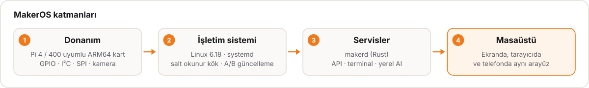</p>

| Katman | Ne işe yarar? |
| --- | --- |
| **1. Donanım** | Sistemin çalıştığı kart. Pinler, sensörler ve kamera bu katmandadır. |
| **2. İşletim sistemi** | Linux çekirdeği ve temel servisler. Sistem dosyaları salt okunurdur, yanlışlıkla bozulmaz. |
| **3. Servisler** | `makerd`: arayüzün istediği her şeyi (dosyalar, terminal, ağ, AI, güncelleme) güvenli biçimde yapan arka plan programı. |
| **4. Masaüstü** | Gördüğünüz arayüz. Web tabanlıdır, bu yüzden ekranda, tarayıcıda ve telefonda aynı şekilde çalışır. |

Ayrıntılar: [Masaüstü](docs/architecture/desktop.md) · [Servisler](docs/architecture/backend.md) · [Yerel AI](docs/architecture/ai-assistant.md) · [Donanım](docs/architecture/hardware.md)

### microSD kart

<p align="center">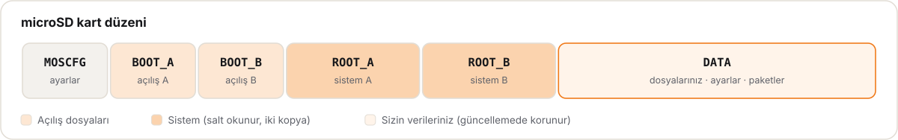</p>

| Bölüm | Ne işe yarar? |
| --- | --- |
| **MOSCFG** | Hangi sistem kopyasıyla açılacağını ve isteğe bağlı Wi-Fi ayarını tutar. Bilgisayarınızda açıp düzenleyebilirsiniz. |
| **BOOT_A / BOOT_B** | Kartı açan dosyalar; her sistem kopyasının kendi açılış bölümü vardır. |
| **ROOT_A / ROOT_B** | İşletim sisteminin iki kopyası. Biri kullanılırken diğeri güncellemeye hazır bekler. |
| **DATA** | Sizin alanınız: dosyalar, ayarlar, projeler ve kurduğunuz paketler. Güncellemeler bu bölüme dokunmaz. |

### Açılış

<p align="center">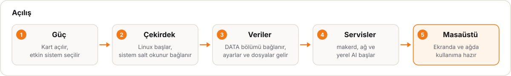</p>

1. **Güç:** Kart açılır ve son çalışan sistem kopyası (A ya da B) seçilir.
2. **Çekirdek:** Linux başlar; sistem dosyaları değiştirilemez (salt okunur) olarak açılır.
3. **Veriler:** `DATA` bölümü denetlenip bağlanır; ayarlarınız ve dosyalarınız yerine gelir.
4. **Servisler:** `makerd`, ağ bağlantısı ve yerel AI başlar. Ağ yoksa kart kendi `MakerOS` Wi-Fi'ını açar.
5. **Masaüstü:** Arayüz ekranda açılır; aynı anda ağdan da erişilebilir.

### Güncelleme

<p align="center">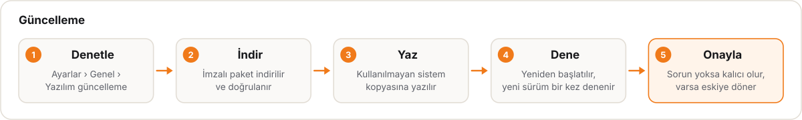</p>

1. **Denetle:** Ayarlar › Genel › Yazılım güncelleme yeni sürüm olup olmadığına bakar. İnternet yoksa aynı paketi bilgisayardan USB-C ile de gönderebilirsiniz ([Kurulum](#setup-guide), seçim 2).
2. **İndir:** Güncelleme paketi indirilir; imzası doğrulanır, değiştirilmiş paket kurulmaz.
3. **Yaz:** Paket, o an kullanılmayan sistem kopyasına yazılır. Çalışan sistem etkilenmez.
4. **Dene:** Kart yeni sürümle **bir kez** açılır.
5. **Onayla:** Her şey yolundaysa yeni sürüm kalıcı olur; açılış başarısızsa kart otomatik olarak eski sürüme döner.

Ayrıntılar: [Önyükleme ve depolama](docs/architecture/boot-and-storage.md)

<a id="packages"></a>

## Paket Kurma (`apt` / `mos pkg`)

<p align="center">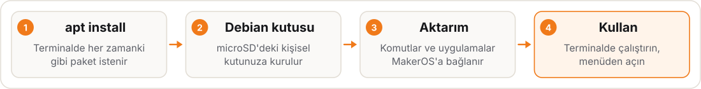</p>

Sistem dosyaları salt okunur olduğu için paketler sisteme değil, microSD'deki **kişisel Debian kutunuza** kurulur. Siz farkı görmezsiniz: komut terminalde çalışır, uygulama menüde görünür.

1. **apt install:** Terminalde Debian'daki gibi paket istersiniz.
2. **Debian kutusu:** Paket, `DATA` bölümündeki kişisel kutunuza kurulur. Sisteme dokunmaz, güncellemelerde silinmez.
3. **Aktarım:** Paketin komutları ve uygulamaları MakerOS'a bağlanır.
4. **Kullan:** Komutu terminalde çalıştırın, uygulamayı menüden açın.

```bash
apt install htop      # paketi kur
htop                  # doğrudan çalıştır
apt remove htop       # kaldır
mos box               # tam Debian kabuğuna gir
```

Ayrıntılar: [Paket yöneticisi](docs/architecture/packages.md)

<a id="plugins"></a>

## Eklentiler

Eklentiler [makeros-plugins](https://github.com/ferhatozcelik/makeros-plugins) deposundan gelir ve MakerOS'ta **Eklentiler › Mağaza**'dan tek tıkla kurulur. Her dosya depodakiyle karşılaştırılır; yeni sürüm çıkınca "Güncelle" düğmesi belirir. Güncel liste: [eklenti mağazası](https://ferhatozcelik.github.io/maker-os/#plugins)

| Eklenti | Ne yapar? |
| --- | --- |
| [Home Assistant](https://github.com/ferhatozcelik/makeros-plugins/tree/main/plugins/homeassistant) | Home Assistant kartın üzerinde çalışır; kendi arayüzü MakerOS temasıyla açılır, seçili varlıklar masaüstü widget'ında. |
| [Pi-hole](https://github.com/ferhatozcelik/makeros-plugins/tree/main/plugins/pihole) | Ağ genelinde reklam ve izleyici engelleme; istatistikler ve engellemeyi aç/kapat. |
| [Chromecast](https://github.com/ferhatozcelik/makeros-plugins/tree/main/plugins/chromecast) | Ağdaki Google Cast cihazlarını bulur; MakerOS ekranını televizyonda paylaşır. |
| [Konya HackerSpace](https://github.com/ferhatozcelik/makeros-plugins/tree/main/plugins/khs) | KHS teması, kapı durumu ve konyahackerspace.org uygulaması. |

**Kendi eklentinizi yazın:** bir eklenti `plugin.json`, `pyproject.toml` ve `main.py`'den oluşan bir Python klasörüdür. MakerOS terminalinde `mos plugin new <ad>` ile şablonu oluşturun; klasör depoya girdiği an mağazada görünür. Ayrıntılar: [eklenti yazma rehberi](https://github.com/ferhatozcelik/makeros-plugins#eklenti-eklemek)

<a id="performance"></a>

## Başarım

Raspberry Pi 4 Model B (4 GB), MakerOS 1.0.0, hız aşırtma yok, microSD kart. Üç MakerOS Bench ölçümünün ortancası (22 Kasım 2026):

| Test | Sonuç |
| --- | ---: |
| CPU tamsayı · tek çekirdek | 0.83 M işlem/sn |
| CPU tamsayı · 4 çekirdek | 3.28 M işlem/sn (4.0×) |
| SHA-256 | 143 MB/s |
| zlib sıkıştırma | 12.3 MB/s |
| Bellek kopyalama | 2.70 GB/s |
| Sıralı okuma / yazma (fsync) | 46.3 / 20.5 MB/s |
| Rastgele 4K okuma / yazma (fsync) | 2,062 / 133 IOPS |
| Yük altında en yüksek sıcaklık | 52.6 °C |

Tüm testler ve aralıklar: [tanıtım sayfası](https://ferhatozcelik.github.io/maker-os/#performance). Testler Python iş yükleridir; disk sonuçları kullanılan microSD karta bağlıdır.

### Diğer kartlarla karşılaştırma

Aynı Pi 4 üzerinde MakerOS ile Geekbench 5.4.0 (Linux AArch64) iki kez çalıştırıldı: **239 / 701** ve **238 / 702** (tek / çok çekirdek; [1](https://browser.geekbench.com/v5/cpu/24851977), [2](https://browser.geekbench.com/v5/cpu/24852002)). Diğer kartlar Geekbench Browser'daki Linux sonuçlarının ortancasıdır (27 Kasım 2026).

<p align="center">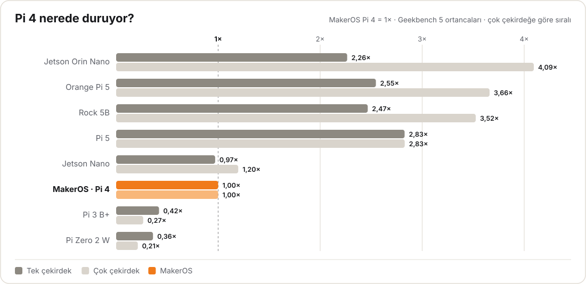</p>

| Kart | İşlemci | Tek çekirdek | Çok çekirdek | Örnek |
| --- | --- | ---: | ---: | ---: |
| Pi Zero 2 W | BCM2710A1 · 4× A53 1.0 GHz | 86 | 149 | 147 |
| Pi 3 B+ | BCM2837B0 · 4× A53 1.4 GHz | 100 | 186 | 199 |
| **Pi 4 · MakerOS** | **BCM2711 · 4× A72 1.5 GHz** | **238** | **701** | **2** |
| Pi 4 · diğer Linux dağıtımları | BCM2711 · 4× A72 1.5 GHz | 237 | 691 | 25 |
| Jetson Nano | Tegra X1 · 4× A57 1.43 GHz | 231 | 839 | 35 |
| Pi 5 | BCM2712 · 4× A76 2.4 GHz | 673 | 1,983 | 125 |
| Rock 5B | RK3588 · 4× A76 + 4× A55 | 587 | 2,471 | 187 |
| Orange Pi 5 | RK3588S · 4× A76 + 4× A55 | 606 | 2,566 | 82 |
| Jetson Orin Nano | Orin · 6× A78AE | 539 | 2,870 | 30 |

- **Aynı kartta:** MakerOS, fabrika saat hızında (1.5 GHz) diğer Linux dağıtımlarıyla (Raspberry Pi OS, Ubuntu vb.; Geekbench dağıtımı ayırmıyor) alınan sonuçların ortancasını geçiyor: **238 / 701**, karşısında **237 / 691**. Hız aşırtma yok, CPU yöneticisi `ondemand`, eklentiler (Home Assistant, Chromecast…) açık. 26 Kasım'daki ilk ölçüm (215 / 634) Home Assistant kapsayıcısı boşta bir çekirdeği meşgul ederken alınmıştı; eklentiler artık düşük öncelikle çalışır.
- Pi 4, Pi 3 B+'nın tek çekirdekte ~2×, çok çekirdekte ~3,4× üstünde; Pi 5 ve RK3588 kartları ise Pi 4'ün yaklaşık 3–4 katı.
- **zstd -19** (aynı dosya, tek iş parçacığı): MakerOS 686 sn, yayımlanmış Raspbian 10 sonucu 291 sn. Kaynak 32 bit zstd 1.3.4 ile alındığından fark yalnız işletim sistemine bağlanamaz.

Kaynak veri ve ölçüm yöntemi: [benchmark/boards.json](benchmark/boards.json) · [MakerOS Bench sonucu](benchmark/results/20261126-2334-makeros-raspberry-pi-4-rev-1-2-4-gb-makeros-1-0-0.md). Grafiği yeniden üretmek için: `python3 docs/assets/diagrams/bench.py`

<a id="setup-guide"></a>

## Kurulum

### 1. Kurun ya da güncelleyin

<p align="center">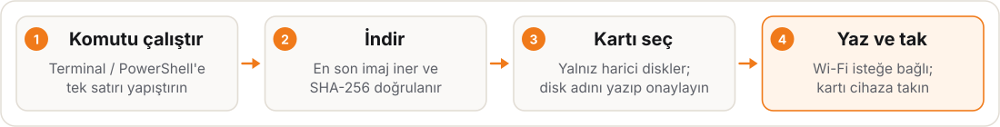</p>

Tek satırlık komut en son sürümü indirir, doğrular ve kurar. Komut başta kartın nasıl bağlı olduğunu sorar:

| Seçim | Ne zaman? | Ne olur? |
| --- | --- | --- |
| **1) SD — kart okuyucu** | Yeni kurulum; kart bilgisayara takılı | Kart baştan yazılır. İsterseniz Wi-Fi bilgileriniz de eklenir; kart ilk açılışta ağınıza kendiliğinden bağlanır. |
| **2) USB — Pi USB-C ile bağlı** | MakerOS zaten kurulu; kart Pi'nin içinde | Pi'yi USB-C kablosuyla bilgisayara bağlayın; kartı çıkarmanız gerekmez. İmzalı güncelleme paketi USB-C üzerinden gönderilir ve yedek bölüme kurulur. Dosyalarınız ve ayarlarınız korunur; yeni sürüm açılmazsa Pi eski sürüme kendiliğinden döner. |

**macOS / Linux** — Terminal'i açıp yapıştırın:

```bash
sh -c "$(curl -fsSL https://raw.githubusercontent.com/ferhatozcelik/maker-os/main/flash.sh)"
```

<p align="center">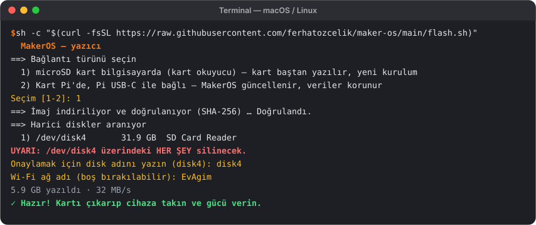</p>

> USB modunda MakerOS yönetici hesabınızla giriş yapılır (varsayılan `maker` / `maker`). Bilgisayarın USB portu Pi'yi beslemeye yetmezse beslemeli bir USB hub kullanın. Seçimi sormadan başlatmak için komutun sonuna `-- -m sd` ya da `-- -m usb` ekleyebilirsiniz: `sh -c "$(curl -fsSL …/flash.sh)" -- -m usb`.

**Windows** — Başlat menüsünde *PowerShell*'e sağ tıklayıp **Yönetici olarak çalıştır**'ı seçin ve yapıştırın (ya da [`flash.cmd`](flash.cmd) dosyasını indirip çift tıklayın):

```powershell
irm https://raw.githubusercontent.com/ferhatozcelik/maker-os/main/flash.ps1 | iex
```

Windows'ta yalnız SD (kart okuyucu) modu vardır; USB modu macOS ve Linux içindir.

<p align="center">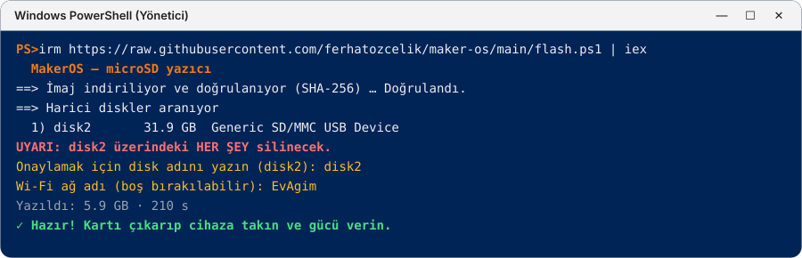</p>

SD modunda adımlar:

| Adım | Ne olur? |
| --- | --- |
| **1. Komutu çalıştır** | Betik GitHub'dan çalışır; ayrıca bir program kurmanız gerekmez. |
| **2. İndir** | En son sürüm indirilir ve SHA-256 özeti doğrulanır. Bozuk ya da değiştirilmiş dosya yazılmaz. |
| **3. Kartı seç** | Yalnız harici / çıkarılabilir diskler listelenir. Bilgisayarınızın diski asla gösterilmez; yazmadan önce disk adını (ör. `disk4`) yazarak onaylarsınız. |
| **4. Yaz ve tak** | İmaj karta yazılır, Wi-Fi bilgisi verdiyseniz `wifi.txt` eklenir ve kart çıkarılmaya hazır olur. |

> Windows kartı yazdıktan sonra "biçimlendirilsin mi?" diye sorarsa **İptal**'e basın. Elle yazmak isterseniz [sürüm sayfasındaki](https://github.com/ferhatozcelik/maker-os/releases/latest) `.img.xz` dosyasını balenaEtcher gibi bir araçla da yazabilirsiniz.

### 2. Başlatın ve bağlanın

1. **Başlatın:** Kartı cihaza takıp gücü verin. İlk açılış bir iki dakika sürer.
2. **Bağlanın:** Aynı ağda `http://maker-os.local/`, USB-C ile `http://10.42.0.1/`; ağ yoksa `MakerOS` Wi-Fi'ına bağlanıp `http://10.42.0.1/kurulum` adresini açın.
3. **Oturum açın:** Varsayılan hesap **`maker` / `maker`**. Parolayı **Ayarlar › Kullanıcı** bölümünden değiştirin.

<a id="documentation"></a>

## Dokümantasyon

Tüm belgeler Türkçe ve İngilizcedir. Giriş sayfası: [`docs/`](docs/README.md)

| Konu | Türkçe | English |
| --- | --- | --- |
| Genel bakış | [overview.md](docs/architecture/overview.md) | [overview.en.md](docs/architecture/overview.en.md) |
| Önyükleme ve depolama | [boot-and-storage.md](docs/architecture/boot-and-storage.md) | [boot-and-storage.en.md](docs/architecture/boot-and-storage.en.md) |
| Masaüstü | [desktop.md](docs/architecture/desktop.md) | [desktop.en.md](docs/architecture/desktop.en.md) |
| Servisler (Rust) | [backend.md](docs/architecture/backend.md) | [backend.en.md](docs/architecture/backend.en.md) |
| Paket yöneticisi | [packages.md](docs/architecture/packages.md) | [packages.en.md](docs/architecture/packages.en.md) |
| Yerel AI asistanı | [ai-assistant.md](docs/architecture/ai-assistant.md) | [ai-assistant.en.md](docs/architecture/ai-assistant.en.md) |
| Ağ ve güvenlik | [network-security.md](docs/architecture/network-security.md) | [network-security.en.md](docs/architecture/network-security.en.md) |
| Donanım | [hardware.md](docs/architecture/hardware.md) | [hardware.en.md](docs/architecture/hardware.en.md) |
| Derleme ve test | [build-and-test.md](docs/development/build-and-test.md) | [build-and-test.en.md](docs/development/build-and-test.en.md) |
| Doğrulama durumu | [validation.md](docs/verification/validation.md) | [validation.en.md](docs/verification/validation.en.md) |
| Marka ve lisans | [branding-and-licensing.md](docs/project/branding-and-licensing.md) | [branding-and-licensing.en.md](docs/project/branding-and-licensing.en.md) |
| HTTP/WS API | [api.md](docs/api.md) | [api.en.md](docs/api.en.md) |

<a id="build-from-source"></a>

## Kaynaktan Derleme

```bash
make -C makerd preview     # bilgisayarınızda önizleme → http://localhost:8080/
make -C shell smoke        # arayüz testleri
./os/build.sh build        # microSD imajını derle → os/out/
```

Kaynak dizinleri: [`os/`](os/README.md) (işletim sistemi ve imaj) · [`makerd/`](makerd/) (servisler) · [`shell/`](shell/README.md) (masaüstü) · [`site/`](site/index.html) ([tanıtım sayfası](https://ferhatozcelik.github.io/maker-os/)). Ayrıntılar: [Derleme ve test](docs/development/build-and-test.md) · [Doğrulama durumu](docs/verification/validation.md)

## Lisans

[MIT](LICENSE). Üçüncü taraf bileşenler: [`NOTICE.md`](NOTICE.md).

MakerOS bağımsız bir açık kaynak projesidir; herhangi bir donanım ya da yazılım üreticisiyle bağı yoktur. Anılan ürün adları sahiplerinin markalarıdır.
