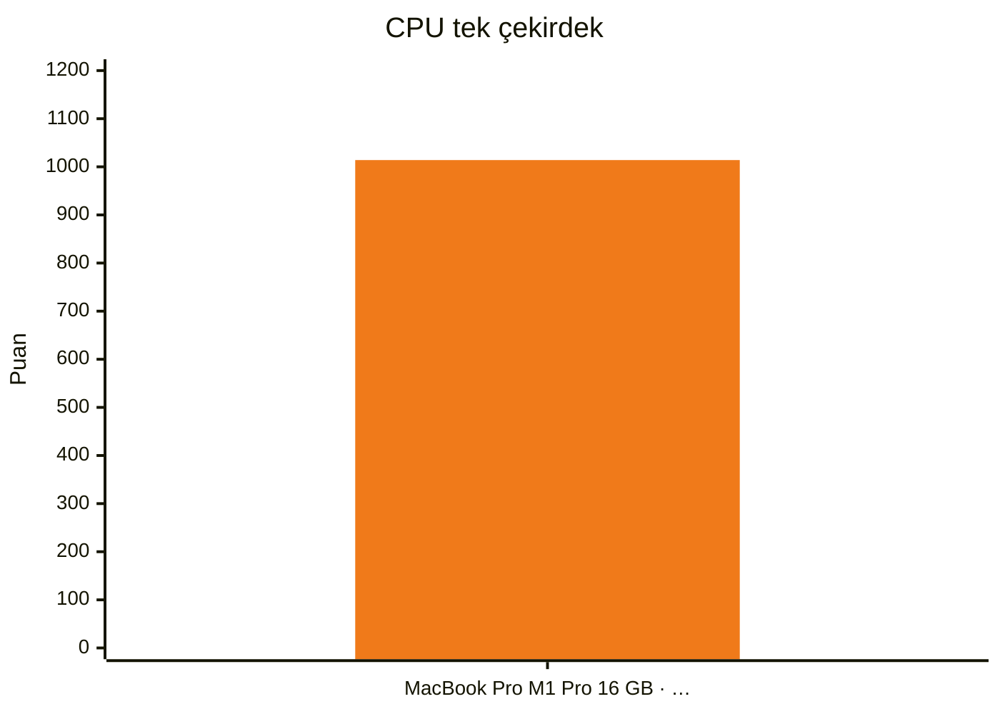
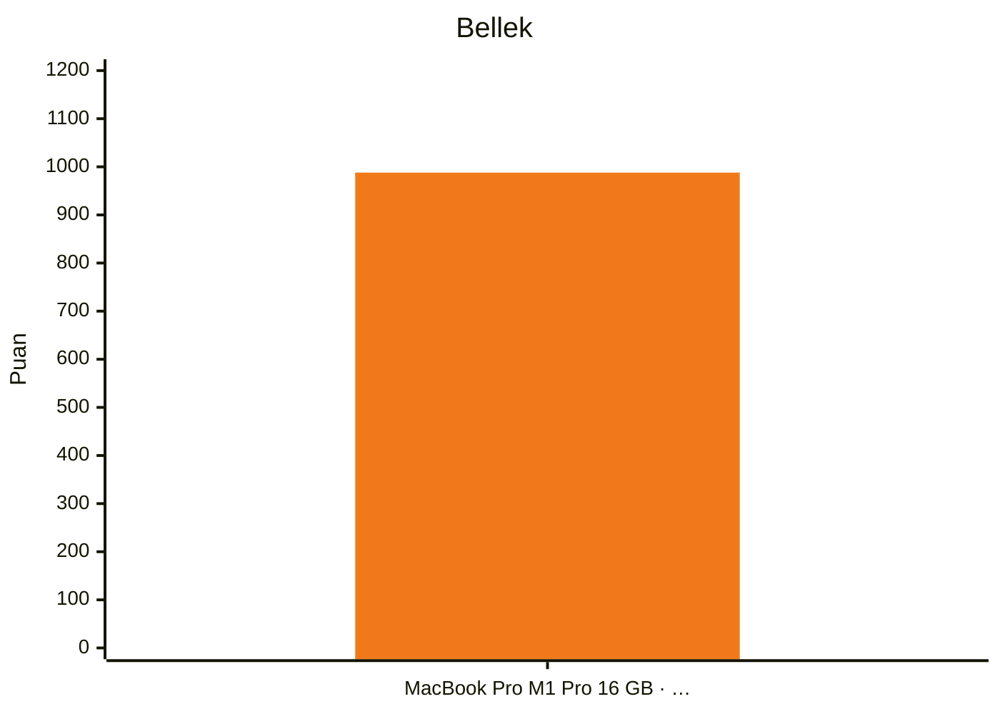
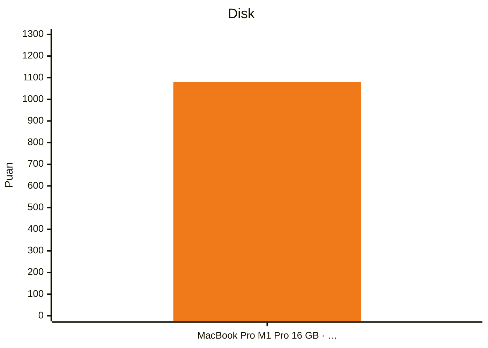

# MakerOS Bench

Tek dosyalık, bağımlılıksız sistem karşılaştırma testi ve topluluk sonuç listesi. macOS, Linux, Raspberry Pi OS ve
[MakerOS](https://github.com/ferhatozcelik/maker-os)'ta çalışır (Python 3.8+, yalnız standart kitaplık).

```sh
curl -fsSLO https://raw.githubusercontent.com/ferhatozcelik/maker-os/main/benchmark/makeros-bench.py
python3 makeros-bench.py                                   # ~1–5 dk; rapor: bench-results/*.md ve *.json
python3 makeros-bench.py --name "Pi 4 4GB · Raspberry Pi OS"  # listede görünecek ad
python3 makeros-bench.py --quick                           # kısa deneme
```

**Ölçülenler:** CPU tek çekirdek (tamsayı, kayan nokta, SHA-256, zlib, JSON, düzenli ifade), CPU çok çekirdek
(tüm çekirdeklerde aynı yük), bellek (kopyalama, nesne ayırma), disk (sıralı yazma/okuma, fsync'li rastgele 4K yazma,
rastgele 4K okuma). Raspberry Pi'de sıcaklık ve kısma (throttling) durumu da rapora girer.

**Puan:** her test sabit referansa göre ölçeklenir — Apple M1 Pro · macOS · Python 3.9 = **1000**. Kategori puanı
testlerin, genel puan kategorilerin geometrik ortalamasıdır. Python iş yükü başarımıdır; aynı betik sürümüyle alınan
sonuçlar karşılaştırılabilir. Kişisel bilgi (makine adı, kullanıcı, IP, seri no) toplanmaz.

**Listeye ekleme:** `bench-results/` içindeki `.json` (ve isterseniz `.md`) dosyasını bu klasördeki `results/`'a pull request ile
gönderin. GitHub Actions dosyayı doğrular; birleştirilince aşağıdaki tablo, grafikler ve
[etkileşimli sayfa](https://ferhatozcelik.github.io/maker-os/benchmark/) kendiliğinden güncellenir.

<!-- BENCH:START -->

_1 sonuç · `tools/render.py` üretir, elle düzenlemeyin._

## Sıralama

| # | Sistem | İşletim sistemi | Genel | CPU 1 | CPU çok | Bellek | Disk | Rapor |
|---:|---|---|---:|---:|---:|---:|---:|---|
| 1 | MacBook Pro M1 Pro 16 GB · macOS | macOS 27.2.1 | **1,025** | 1,014 | 1,018 | 988 | 1,081 | [rapor](results/20261121-1611-macos-macbook-pro-m1-pro-16-gb-macos.md) |

Referans (Apple M1 Pro · macOS · Python 3.9) = 1000 puan. Yüksek = iyi. Etkileşimli grafikler: [GitHub Pages](https://ferhatozcelik.github.io/maker-os/benchmark/).

## Grafikler









## Analiz

Henüz tek sonuç var. Başka bir sistemde (ör. Raspberry Pi OS ya da MakerOS) çalıştırıp `results/` klasörüne
eklediğinizde bu bölüm sistemleri kendiliğinden karşılaştırır.

<!-- BENCH:END -->

Bu klasör [MakerOS](../README.md) deposunun parçasıdır (MIT).
