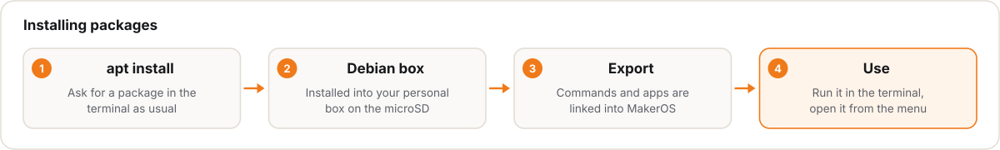

# Package Manager (`mos pkg` / `apt`)

[Türkçe](packages.md) · [English](packages.en.md)

The MakerOS root filesystem is read-only (EROFS) and is replaced as a whole by A/B updates. You can still install packages just like on Debian: `mos pkg` (or `apt` / `apt-get`) installs packages into a per-user, rootless **Debian trixie box**. The box lives on the microSD `DATA` partition (`/data/home/<user>`), so OTA updates never remove installed packages and the base system stays clean.

Implementation: [`os/board/rpi4/rootfs-overlay/usr/bin/mos`](../../os/board/rpi4/rootfs-overlay/usr/bin/mos) and [`apt`](../../os/board/rpi4/rootfs-overlay/usr/bin/apt) (`apt-get` links to it).

## How it works

1. The box is created on first use (the same box as `mos box`: `mosbox-debian`). `$HOME` is shared; GPIO, I²C, SPI, camera and serial devices are passed through.
2. `apt` runs as root inside the box; since the box is rootless, that privilege does not reach the host.
3. After installation the package's files are scanned with `dpkg -L`:
   - **Commands** are written as small forwarding scripts in `~/.local/bin`, which is on `PATH`, so they run directly from the terminal.
   - **Desktop apps** (`.desktop`) are copied to `~/.local/share/applications` with their `Exec` line rewritten to run inside the box. `makerd` scans this directory, so the app shows up in the MakerOS menu with a "(debian)" suffix.
4. Commands that already exist on MakerOS (e.g. `python3`, `git`) are **not** exported, so system tools are never shadowed. Use the box version with `mos box run debian -- python3`.
5. Exports are cleaned up or refreshed automatically on remove and upgrade. The mapping of files to packages is kept in `~/.local/share/mos/pkg/debian/<package>.files`.

## Commands

| Command | Equivalent | Description |
| --- | --- | --- |
| `mos pkg install <pkg…>` | `apt install` | Installs packages and exports commands and apps |
| `mos pkg remove <pkg…>` | `apt remove` / `purge` | Removes packages and their exports |
| `mos pkg search <term>` | `apt search` | Searches the Debian archive |
| `mos pkg show <pkg>` | `apt show` | Package details |
| `mos pkg list` | — | Packages installed with `mos pkg` (`apt list …` gives the full list) |
| `mos pkg update` / `upgrade` | `apt update` / `upgrade` | Refreshes the index / upgrades packages and refreshes exports |
| `mos pkg export <cmd>` | — | Manually exports any command from the box (`unexport` reverts) |
| `mos box [name]` | — | Enters a full Debian shell in the box (`sudo apt`, `gcc`, `make` …) |
| `mos box run [name] -- <cmd>` | — | Runs a single command in the box |

`apt` and `apt-get` forward the subcommands above to `mos pkg`; anything else (`apt policy`, `apt depends` …) goes straight to `apt` inside the box. `sudo apt install …` works too: the operation runs in the box of the user who invoked `sudo`. Set `MOS_PKG_BOX=<name>` to use a different box.

## Limitations

- The box is Debian **trixie arm64**; only packages built for that architecture can be installed.
- Kernel modules, boot services (systemd units) and packages that modify the host are not meaningful in the box; system components ship with the MakerOS image and OTA updates.
- Graphical apps open via Wayland; legacy X11-only apps may not work.
- Packages take space on the `DATA` partition; `mos status` shows free space.
