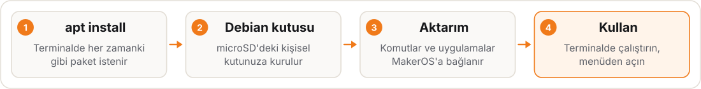

# Paket Yöneticisi (`mos pkg` / `apt`)

[Türkçe](packages.md) · [English](packages.en.md)

MakerOS'un kök dosya sistemi salt okunurdur (EROFS) ve A/B güncellemelerle bütün olarak değiştirilir. Buna rağmen Debian'daki gibi paket kurabilirsiniz: `mos pkg` (ya da `apt` / `apt-get`) paketleri kullanıcıya ait, rootless bir **Debian trixie kutusuna** kurar. Kutu microSD'deki `DATA` bölümünde (`/data/home/<kullanıcı>`) durur. Bu yüzden OTA güncellemeleri kurulu paketleri silmez, sistem de temiz kalır.

Uygulama: [`os/board/rpi4/rootfs-overlay/usr/bin/mos`](../../os/board/rpi4/rootfs-overlay/usr/bin/mos) ve [`apt`](../../os/board/rpi4/rootfs-overlay/usr/bin/apt) (`apt-get` ona bağlantıdır).

## Nasıl çalışır?

1. Kutu yoksa ilk kullanımda oluşturulur (`mos box` ile aynı kutu: `mosbox-debian`). `$HOME` paylaşılır; GPIO, I²C, SPI, kamera ve seri aygıtlar kutuya geçirilir.
2. `apt` kutunun içinde root olarak çalışır; kutu rootless olduğu için bu yetki ana sisteme taşmaz.
3. Kurulumdan sonra paketin dosyaları `dpkg -L` ile taranır:
   - **Komutlar** `~/.local/bin` altına küçük yönlendirme betikleri olarak yazılır. Bu dizin `PATH`'te olduğu için komut terminalde doğrudan çalışır.
   - **Masaüstü uygulamaları** (`.desktop`) `~/.local/share/applications` altına kopyalanır ve `Exec` satırı kutuda çalışacak şekilde değiştirilir. `makerd` bu dizini tarar; uygulama MakerOS menüsünde "(debian)" ekiyle görünür.
4. MakerOS'ta zaten bulunan bir komut (ör. `python3`, `git`) **aktarılmaz**; sistem araçları gölgelenmez. Kutudaki sürüm için: `mos box run debian -- python3`.
5. Kaldırma ve güncellemede aktarımlar kendiliğinden temizlenir ya da yenilenir. Hangi dosyanın hangi paketten geldiği `~/.local/share/mos/pkg/debian/<paket>.files` dosyasında tutulur.

## Komutlar

| Komut | Karşılığı | Açıklama |
| --- | --- | --- |
| `mos pkg install <paket…>` | `apt install` | Paketi kurar, komutları ve uygulamaları aktarır |
| `mos pkg remove <paket…>` | `apt remove` / `purge` | Paketi kaldırır, aktarımları siler |
| `mos pkg search <sözcük>` | `apt search` | Debian depolarında arar |
| `mos pkg show <paket>` | `apt show` | Paket bilgisi |
| `mos pkg list` | — | `mos pkg` ile kurulan paketler (`apt list …` tüm listeyi verir) |
| `mos pkg update` / `upgrade` | `apt update` / `upgrade` | Paket listesini yeniler / paketleri günceller ve aktarımları tazeler |
| `mos pkg export <komut>` | — | Kutudaki herhangi bir komutu elle aktarır (`unexport` geri alır) |
| `mos box [ad]` | — | Kutunun tam Debian kabuğuna girer (`sudo apt`, `gcc`, `make` …) |
| `mos box run [ad] -- <komut>` | — | Kutuda tek bir komut çalıştırır |

`apt` ve `apt-get` yukarıdaki alt komutları `mos pkg`'ye yönlendirir; diğerleri (`apt policy`, `apt depends` …) doğrudan kutudaki `apt`'ye gider. `sudo apt install …` da çalışır: işlem `sudo`yu çağıran kullanıcının kutusunda yapılır. Ayrı bir kutu kullanmak için `MOS_PKG_BOX=<ad>` verin.

## Sınırlar

- Kutu Debian **trixie arm64**'tür; yalnız bu mimari için derlenmiş paketler kurulabilir.
- Çekirdek modülleri, açılış hizmetleri (systemd birimleri) ve ana sistemi değiştiren paketler kutuda anlamlı değildir; sistem bileşenleri MakerOS imajıyla ve OTA ile gelir.
- Grafik uygulamalar Wayland ile açılır; yalnız X11 destekleyen eski uygulamalar çalışmayabilir.
- Paketler `DATA` bölümünde yer kaplar; boş alanı `mos status` gösterir.
